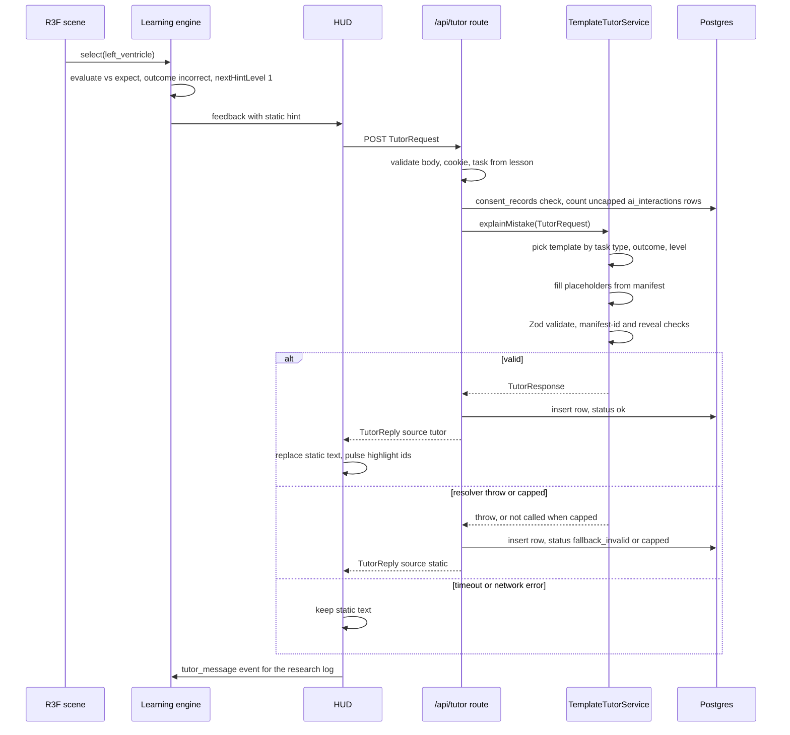

# AI Tutor

The tutor turns structured scene state and a deterministic evaluation result into one or two short sentences: what the learner did, and what to notice next. In **MVP** it is a deterministic template engine in `packages/tutor`: hints come from the lesson's hint ladder, and mistake explanations are assembled from manifest data (component `description`, `relations`, `tags`). It never decides correctness, never sees video or landmarks, and never names anything outside the model manifest. A locally run open-weights model is a **V1** candidate behind the same `TutorService` seam, gated by measurement; a hosted metered API is excluded by project rule.

## Design principle

Locked positions 5 and 7 fix the tutor's shape:

| Rule | Consequence |
|---|---|
| The tutor never grades | The learning engine evaluates every action against the task `expect` block ([06-learning-engine.md](06-learning-engine.md)); the tutor receives the outcome and may only explain it |
| The tutor never sees pixels | Inputs are the `SceneState` snapshot (`r3f-interaction` section 11), the task with its `expect`, the evaluation result, and the hint level |
| The tutor only knows the manifest | Every subject noun in a tutor sentence is a component `name`, `description`, humanised `tag`, the task `prompt`, or the humanised `expect.attribute` of a `compare` task. In MVP this holds by construction: templates contain no subject nouns of their own |
| The tutor is optional | Every lesson is completable with static hints; an unresolvable template degrades to the static hint for the same level |
| Nothing is paid | No usage-billed service at any tier; V1 adds only a model running on hardware the project already owns |

Treating all eight brief capabilities as language-model features would be a mistake even with a free model: adaptive difficulty and learning paths are deterministic functions of mastery and belong to the engine; quiz generation breaks the declarative-evaluation guarantee.

## The eight capabilities

| # | Capability | Tier | What it means here | Reason for the tier |
|---|---|---|---|---|
| 1 | Explaining concepts | **MVP** static, **V1** rephrased | Show the component `description` or hotspot `body` verbatim; a V1 local model may rephrase | Verbatim manifest text already teaches the fact |
| 2 | Answering questions | **V1** | Free-text question about the visible model, answered by a local model from manifest context only | Needs a chat UI, a local model, and injection hardening |
| 3 | Providing hints | **MVP** | Return the authored hint for `nextHintLevel`; resolve `tutor: true` hints to a template quoting the prompt | Core loop; the ladder is already authored per task |
| 4 | Generating quiz items | **Future** | Produce new `identify`, `compare`, or `sequence` tasks | Each item needs a valid `expect` block, a verified fact, and a human check; validation costs more than authoring saves, and hallucinated anatomy in an assessment is a learning harm |
| 5 | Adapting difficulty | **V1** | Explain why the engine moved the learner up or down | The decision is a deterministic mastery rule; the tutor narrates, never chooses |
| 6 | Explaining mistakes | **MVP** | After an incorrect or partial attempt: what was done, how it differs from what was asked, what to notice next | Core loop; the template set below |
| 7 | Personalised learning paths | **Future** | Recommend the next lesson from mastery history | Needs a catalogue; the recommendation should be a deterministic prerequisite graph |
| 8 | Summarising progress | **V1** | Short narrative on the mastery screen from per-objective scores | The mastery screen works with numbers alone |

## Tutor engine

The decision is which engine fills the `TutorService` seam. The interface below is declared identically in `packages/tutor/src/tutor-service.ts` and copied by [03-system-architecture.md](03-system-architecture.md); engines swap without touching the HUD or the learning engine.

```ts
export interface TutorService {
  /** Return the authored hint at req.hintLevel (level 3 may reveal). MVP. */
  hint(req: TutorRequest): Promise<TutorResponse>;
  /** Explain an incorrect or partial attempt without contradicting the engine. MVP. */
  explainMistake(req: TutorRequest): Promise<TutorResponse>;
  /** Narrate per-objective mastery for the mastery screen. Optional; V1. */
  summarise?(req: TutorRequest): Promise<TutorResponse>;
}
```

`question` (capability 2, **V1**) gets a method only when its chat UI is designed; it is not in the seam yet.

In every tier the engine runs inside the `/api/tutor` route handler on our own server, same origin as the page; there is no third-party egress. `TUTOR_ENGINE` selects the engine: `template` by default, `local` when `TUTOR_LOCAL_URL` is set. `TUTOR_ENGINE=local` applies only to an app instance running on the lab laptop that also runs the model; the hosted Vercel deployment always uses `template`. As built (Phase 5), the route has no `local` or Python (`TUTOR_SERVICE_URL`) branch yet: the V1 engine classes still throw, so the route always runs `TemplateTutorService`. The branch is added with the V1 measurement gate (noted as a `ponytail:` comment in `apps/web/app/api/tutor/route.ts`).

| Option | Pros | Cons | Fit for solo dev | Verdict |
|---|---|---|---|---|
| Template tutor: typed template map filled from manifest data | Zero cost; sub-millisecond engine time; reproducible; unit-testable; no model process to run | No open questions; wording bounded by the author; each new task type needs a template row | Best: about 200 lines plus tests | **MVP** recommended |
| Local open-weights model via Ollama on the lab laptop, behind `/api/tutor` | Free; data stays on the laptop; can rephrase and answer questions; no browser GPU cost | Lab-laptop instance only (above); laptop latency unknown; needs the full guardrail set | Moderate: one HTTP client plus prompt assembly | **V1** candidate, gated below |
| In-browser WebLLM (WebGPU) | Free; any deployment; nothing leaves the browser | Shares the integrated GPU with MediaPipe's GPU delegate and R3F, competing directly with the 30 fps budget; multi-gigabyte download; WebGPU required | Moderate to hard: memory pressure and scheduling | **V1** candidate, gated below; expected to fail the fps gate |
| Hosted metered API | Best prose | Paid per token; excluded by project rule | Not applicable | Rejected |

Eight-point checklist for the template tutor:

| Point | Template tutor |
|---|---|
| Appropriate | Every MVP tutor message is a function of (task type, outcome, hint level, selected component, expected component): a lookup, not a language problem |
| Limitations | Fixed phrasing; a relation or tag missing from the manifest yields a blander sentence; subject words such as "blood" must stay in manifest text, not templates |
| Browser performance | One same-origin `fetch` per call; engine time is string substitution, well under a millisecond; nothing on the render thread |
| Accessibility | Plain text, second person, no markdown; highlights accompany text, never replace it |
| Privacy | The request goes only to our own `/api/tutor` route handler; no third-party egress; the consent-gated research log and `ai_interactions` row are the only persistence |
| Scalability | Microseconds of route CPU plus one row insert per call; the call caps bound it |
| Complexity | One typed const map, one resolver, one Zod check; testable without mocks |
| Necessary | Yes for capabilities 3 and 6. The simpler alternative, static hints only, cannot say what the learner selected or where they dropped it |

Measurement gate for either V1 candidate, run on the lab laptop with MediaPipe and R3F live:

| Gate | Threshold | Why |
|---|---|---|
| Hint latency | p95 under `HINT_LATENCY_BUDGET_MS` (3,500 ms) over 50 `explain_mistake` calls | Later than this, the static hint has already done the job |
| Frame budget | p5 combined frame rate at or above 30 fps during inference | Locked position 6 |
| Guardrail pass rate | 100 percent of 50 sampled replies pass schema, manifest-id, and reveal checks | A model that leaks the answer at level 1 is worse than no model |
| Reproducibility | Temperature 0 and a fixed seed give identical text for identical requests | Preserves the research advantage below |

No orchestration library at any tier: templates need none, and a local model needs one `fetch` plus the existing Zod check.

## Request and response payloads

The HUD builds `TutorRequest` from the engine's feedback and the scene snapshot and POSTs it to `/api/tutor`. The route loads lesson and manifest by `lessonId` from `@grasp/content`, and loads the task (prompt, `expect`, objective statement) from the lesson by `task.id`; the body's copy of `task` and `evaluation.expected` is ignored and replaced, so the request never supplies vocabulary or the answer. The only Phase 5 change is `evaluation.stepNo` for `sequence`: the engine grades a wrong step immediately, so the client knows which step broke, and the request had no other field to carry it.

```ts
type TutorRequest = {
  sessionId: string;                       // random UUID; never an account id
  lessonId: string; activityId: string;
  kind: "hint" | "explain_mistake"         // MVP
      | "question" | "summary";            // V1
  hintLevel: 1 | 2 | 3;                    // from feedback.nextHintLevel; 3 may reveal
  task: { id: string; type: TaskType; prompt: string; objectiveStatement: string; expect: TaskExpect };
                                           // only task.id is read; the route replaces the rest from the lesson
  evaluation: { outcome: "correct" | "partial" | "incorrect"; expected: TaskExpect;   // expected: replaced by the route
                actual: { type: string; componentId?: string; socketId?: string; hotspotId?: string };  // hotspotId accepted, ignored by the tutor
                attemptNo: number; hintsUsed: number;
                stepNo?: number } | null;  // sequence only: 1-based step that broke = steps placed before the attempt + 1
  scene: SceneState;                       // r3f-interaction section 11
  question?: string;                       // V1 only; max 280 chars; untrusted
  locale: "en";
};
```

A concrete instance for worked example 1 (learner selected `left_ventricle`, task expects `right_ventricle`; the task is `t_g1b`, a test-only variant of `t_g1` that asks for the right ventricle). The `scene` block follows `SceneState` from `r3f-interaction` section 11: ids and numbers only, roughly 1 KB, no pixels. Positions are illustrative, in manifest units; `heart_v1` has six components. The template engine reads no `scene` field (the route only bounds its size at 8,000 characters); it is sent for the research payload and a **V1** model.

```json
{
  "sessionId": "5f1c7a2e-9b0d-4c7e-8a4b-2d6e1f3a9c01",
  "lessonId": "anatomy.heart.chambers_v1",
  "activityId": "act_guided",
  "kind": "explain_mistake",
  "hintLevel": 1,
  "task": {
    "id": "t_g1b",
    "type": "identify",
    "prompt": "Point to the right ventricle.",
    "objectiveStatement": "Identify the four chambers of the heart",
    "expect": { "componentId": "right_ventricle" }
  },
  "evaluation": {
    "outcome": "incorrect",
    "expected": { "componentId": "right_ventricle" },
    "actual": { "type": "select", "componentId": "left_ventricle" },
    "attemptNo": 1,
    "hintsUsed": 0
  },
  "scene": {
    "modelId": "heart_v1",
    "camera": { "azimuth": 20, "elevation": 15, "distance": 40 },
    "components": {
      "left_ventricle":     { "socketId": "socket_left_ventricle",   "position": [2.5, -3.0, 0.5],  "visible": true },
      "right_ventricle":    { "socketId": "socket_right_ventricle",  "position": [-2.0, -3.2, 1.0], "visible": true },
      "left_atrium":        { "socketId": "socket_left_atrium",      "position": [2.0, 2.5, -1.0],  "visible": true },
      "right_atrium":       { "socketId": "socket_right_atrium",     "position": [-2.5, 2.2, 0.0],  "visible": true },
      "aorta":              { "socketId": "socket_aorta",            "position": [0.5, 6.0, 0.0],   "visible": true },
      "pulmonary_artery":   { "socketId": "socket_pulmonary_artery", "position": [-1.0, 5.0, 1.5],  "visible": true }
    },
    "hovered": "left_ventricle",
    "grabbed": null,
    "lastEvent": { "type": "select", "componentId": "left_ventricle", "t": 184230 }
  },
  "locale": "en"
}
```

```ts
type TutorResponse = {
  kind: "hint" | "explain_mistake" | "answer" | "summary" | "refusal";
  text: string;                            // <= 320 characters, plain sentences
  referencedComponentIds: string[];        // every component the text names; subset of manifest ids
  highlight: string[];                     // ids the HUD may pulse; empty at level 1
  revealsAnswer: boolean;                  // false when hintLevel < 3
};
```

Every engine's output passes the Zod schema in `packages/tutor/src/response-schema.ts` and the guardrail check inside the resolver. The route answers `TutorReply` (`apps/web/lib/api-client.ts`):

```ts
type TutorReply = {
  status: TutorCallStatus;          // ok | fallback_invalid | capped from the route
  source: "tutor" | "static";       // "tutor" only when status is ok
  interactionId: string;            // ai_interactions.id; every answered call writes a row
  latencyMs: number;                // route-measured
  response: TutorResponse;          // the template result, or the static hint it fell back to
};
```

The HUD uses `response` only when `source` is `tutor`; otherwise the static text already on screen stays.

## The template tutor

### Hint pass-through

`hint(req)` returns the authored `Hint` at `req.hintLevel`: `text` to `text`, `highlight` to `highlight`, `revealsAnswer` true only at level 3. A `tutor: true` hint with no `text` resolves to `HINT_FALLBACK` ("Look again at the task: {prompt}") plus its static `highlight`. Recommendation to `learning-designer`, unchanged: require `text` on every `tutor: true` hint so the flag is a no-op in MVP.

### Mistake explanations

`explainMistake(req)` composes up to three parts. Level 1 is the body; level 2 appends a narrowing clause; level 3 appends the reveal sentence and fills `highlight`.

| Task type | Outcome | Level-1 body | Level-2 narrowing source |
|---|---|---|---|
| `identify` | `incorrect` | "You selected the {selectedName}: {selectedDescription} That is not the part the task asks for." | Relation between selected and expected (`opposite_of` and `connects_to` checked in either direction, `contains` from selected), else a tag contrast, else the prompt |
| `place` | `incorrect` (wrong part) | "You moved the {selectedName}, which is not the part the task asks for. {selectedDescription}" | Same relation lookup |
| `place` | `partial` (right part, wrong socket) | "The {selectedName} is the right part, but that socket is in the {socketRegion} and is not where it belongs." | Selected and expected are the same part, so no relation or tag contrast exists and the `none` clause fires |
| `remove` | `incorrect` | "You moved the {selectedName}, but the task asks you to detach a different part. {selectedDescription}" | Same relation lookup |
| `sequence` | `incorrect` | "The order broke at step {stepNo}: the {selectedName} does not follow the {priorStepName}." Step 1: "The sequence starts with a different part than the {selectedName}." | Relation from the prior (last right) step's component to the expected step, so the clause reads "follow the flow one step on" from where the learner was right; at step 1, from the selected part. The tag contrast always compares the selected part with the expected one |
| `compare` | `incorrect` | "You chose the {selectedName}. {selectedDescription} The question is about {attribute}, so compare the two parts on that alone." | The prompt |

The map is total over task type × outcome so the resolver never misses a key. The engine (`packages/learning/src/evaluate.ts`) produces `partial` only for `place`, so four cells are unreachable today and hold these bodies:

| Cell | Body |
|---|---|
| `identify.partial` | "You selected the {selectedName}. Look again at the task: {prompt}" |
| `remove.partial` | "You detached the {selectedName} but it settled back into its socket. Drop it further away." |
| `sequence.partial` | "The parts are right but the order is not. It broke at step {stepNo}, after the {priorStepName}." |
| `compare.partial` | "You chose the {selectedName}. Look again at the task: {prompt}" |

Narrowing clauses by relation found:

| Key | Clause |
|---|---|
| `opposite_of` | "The part you need is the counterpart of the {selectedName} on the other side." |
| `connects_to` | "The {selectedName} connects directly to the part you need; follow the flow one step on." |
| `connects_from` | "The part you need connects directly into the {selectedName}; follow the flow one step back." |
| `contains` | "The part you need is inside the {selectedName}." |
| `tag_contrast` | "The part you chose is {selectedTag}; the part you need is {expectedTag}." |
| `none` | "Reread the task: {prompt}" |

Reveal sentences (level 3 only), one per task type as in `REVEAL_TEMPLATES`: "The part you need is the {expectedName}; it is highlighted now." for `identify`; "The {expectedName} belongs in the {restRegion}; it is highlighted now." for `place` (the scene's `highlight` command pulses components only, not sockets, so the part is what lights up); "Detach the {expectedName}; it is highlighted now." for `remove`; "Step {stepNo} is the {expectedName}; it is highlighted now." for `sequence`; "The answer is the {expectedName}; it is highlighted now." for `compare`. `highlight` is always `[expected component id]`.

| Placeholder | Source |
|---|---|
| `{selectedName}`, `{selectedDescription}` | Manifest component for `evaluation.actual.componentId` |
| `{expectedName}` | Manifest component for the expected id (level 3 only) |
| `{selectedTag}`, `{expectedTag}` | First tag present on one component and absent on the other, underscores to spaces |
| `{socketRegion}`, `{restRegion}` | Derived from socket `transform.position`: `y` sign gives "upper" or "lower", `x` sign gives "patient's left" or "patient's right". Axis convention: manifests are authored in anterior view with the manifest `defaultCamera` facing the sternum, so positive `x` is the patient's left (the viewer's right) and positive `y` is superior; a manifest authored otherwise must say so, and a flat subject may need an authored region label (open question 2) |
| `{stepNo}`, `{priorStepName}` | `evaluation.stepNo` (default 1; out of range falls back to 1) and the `expect.steps` component before it |
| `{attribute}` | `expect.attribute`, underscores to spaces |
| `{prompt}` | `task.prompt` |

```text
explainMistake(req):                            // manifest and lesson injected by the route
  task = lesson.task(req.task.id)               // never the body's copy; unknown id throws
  sel = manifest.component(req.evaluation.actual.componentId)   // unknown id throws
  exp = expectedComponent(task, req.evaluation.stepNo)          // for sequence, step stepNo
  prior = sequence && stepNo > 1 ? steps[stepNo - 2] : none
  answerIsPart = not (place and partial)        // in a place partial only the socket is the answer
  if level < 3 and answerIsPart and sel.description names exp: selectedDescription = ""
  text = fill(MISTAKE_TEMPLATES[task.type][outcome])            // or the sequence step-1 variant
  if level == 2: text += " " + fill(NARROW_CLAUSES[relationKind(prior ?? sel, exp) ?? tagContrast(sel, exp) ?? "none"])
  if level == 3: text += " " + fill(REVEAL_TEMPLATES[task.type]); highlight = [exp.id]
  res = finish(text)                            // truncate, Zod, no "{x}" left, every id in the manifest
  if level < 3: reject if res.revealsAnswer or res.highlight nonempty
                reject if answerIsPart and (res.text minus task.prompt) contains exp.name
  return res                                    // any throw: route answers the static hint, status fallback_invalid
```

### Request flow

The HUD POSTs the `TutorRequest` to `/api/tutor` on the same origin. The route handler validates the body, loads the task from the lesson, checks consent, enforces the call caps, calls the selected engine (`TemplateTutorService` in MVP), writes the `ai_interactions` row, and returns `TutorReply` with its `interactionId`; the client emits `tutor_message` to the event log on receipt. The static hint is already on screen before the request leaves, so the round trip is never on the critical path.

Route rejections, all **MVP** and none of them writing a row:

| Answer | When |
|---|---|
| 400 | Body fails the Zod schema (`kind` other than `hint` or `explain_mistake` included); `explain_mistake` without an `incorrect` or `partial` evaluation; activity is not `guided` or `challenge` |
| 403 | Body `sessionId` differs from the session cookie; the session has no consent record without `withdrawn_at` |
| 404 | Unknown lesson, activity, or task id |
| 503 | No database (an unsaved run); the client does not call the route at all in that case (below) |

Call caps count only rows whose status is not `capped`, so a capped call is logged but never uses up a cap.



### HUD placement

As built in `apps/web/app/(study)/lesson/[lessonId]/lesson-client.tsx` (`callTutor`). All rows **MVP**.

| Trigger | Call | Where the text goes |
|---|---|---|
| `incorrect` or `partial` attempt in a guided or challenge activity, not the synthesised remediation micro-task | `explain_mistake` at `feedback.nextHintLevel`, with `stepNo` for `sequence` | Replaces the feedback card's text for that attempt, plus " Moving on." only when the task advanced (`next_task`, `next_activity`, `lesson_complete`; not on retry or remediate, the same rule as the static feedback text); the card then stays up for `TUTOR_BANNER_MS` (10 s) instead of the usual 4 s. Ignored if a newer feedback card has replaced it |
| Learner presses the hint button and the authored hint has `tutor: true` and no `text` | `hint` at that level, `evaluation: null` | Replaces the hint card's text, if the learner is still on the same task. With authored `text` no call is made: it would return that same text and spend a cap slot. Every `tutor: true` hint in `chambers_v1` has `text`, so MVP makes no `hint`-kind call, which is the no-op this doc recommends under [Hint pass-through](#hint-pass-through) |
| Earned hint (shown after a failed attempt) | None | The `explain_mistake` call on that attempt already covers it, and the cap is 1 call per attempt |
| Response `highlight` non-empty | n/a | The ids are pulsed with the scene's `highlight` command |

Static text is always on screen first. Every call logs one `tutor_message` whose payload is built from named scalar fields `{ interactionId, status, source, taskId, kind, hintLevel, latencyMs }` (never by spreading the reply); `SessionLogger.log` in `packages/learning/src/logger.ts` throws on any object-valued payload value before taking a `seq`, so text or `SceneState` cannot slip into the event log. On any failure the client keeps the static text and logs `tutor_message` with `interactionId: null`, `source: "static"`, and status `fallback_timeout` (`AbortSignal.timeout` at `HINT_LATENCY_BUDGET_MS` in `askTutor`) or `fallback_error` (any other rejection, including a 4xx or 503). These two statuses therefore exist only in the event log; `ai_interactions` holds `ok`, `fallback_invalid`, and `capped` in MVP. A failed call usually leaves no row, but `AbortSignal.timeout` aborts only the client: a slow route (for example a sleeping free-tier Postgres) can still insert a late row, which the client's `tutor_message` (`interactionId: null`, `fallback_timeout`) cannot join.

The client calls only when `tutorOn` holds: the session is saved (a database answered `POST /api/session`) and the lesson URL does not carry `?tutor=off`. The URL flag exists for the Phase 5 parity check: tutor off and every call capped must give identical event streams except for `tutor_message` events (decided 2026-10-30). It is not recorded per session (open question 4, resolved).

There is no "Explain" pill in **MVP** (user decision 2026-10-30): mistakes in guided and challenge are explained automatically, and with the 1-per-attempt cap a pill pressed after that explanation could return only the static hint.

## Worked examples

Ids, descriptions, and socket positions are from `content/models/heart_v1.json`; tasks are from `chambers_v1`. Each output is `TutorResponse.text`. Examples 1 to 3 use `t_g1b`, a test-only variant of `t_g1` that asks for the right ventricle (`chambers_v1` has no guided right-ventricle task); `template-tutor-service.test.ts` asserts them verbatim.

| # | Situation | Level | Output |
|---|---|---|---|
| 1 | `identify`, task asks for `right_ventricle`, learner selects `left_ventricle` (the brief's scenario) | 1 | "You selected the Left Ventricle: Thick-walled chamber that pumps oxygenated blood into the aorta. That is not the part the task asks for." |
| 2 | Same request | 2 | Level-1 text plus "The part you need is the counterpart of the Left Ventricle on the other side." (from `left_ventricle.relations.opposite_of`) |
| 3 | Same request | 3 | Level-1 text plus "The part you need is the Right Ventricle; it is highlighted now." with `highlight: ["right_ventricle"]`, `revealsAnswer: true` |
| 4 | `place` partial, `t_c3` expects `left_atrium` in `socket_left_atrium`; learner drops it in `socket_right_atrium` (x −2.1, y 5.1) | 1 | "The Left Atrium is the right part, but that socket is in the upper patient's right region and is not where it belongs." |
| 4b | Same request | 3 | Level-1 text plus "The Left Atrium belongs in the upper patient's left region; it is highlighted now." with `highlight: ["left_atrium"]` (the part pulses; sockets cannot) |
| 5 | `place` incorrect, `t_g3` expects `aorta`; learner drops `pulmonary_artery` into `socket_aorta` | 2 | "You moved the Pulmonary Artery, which is not the part the task asks for. Carries deoxygenated blood from the right ventricle to the lungs. The part you chose is deoxygenated; the part you need is oxygenated." (no relation between the vessels, so the tag contrast fires) |
| 6 | `sequence` `t_c5`; learner selects `right_atrium` then `left_atrium` | 2 | "The order broke at step 2: the Left Atrium does not follow the Right Atrium. The Right Atrium connects directly to the part you need; follow the flow one step on." |
| 7 | `compare` (guided variant of `t_a4`), learner selects `right_ventricle` | 1 | "You chose the Right Ventricle. Pumps deoxygenated blood into the pulmonary artery. The question is about wall thickness, so compare the two parts on that alone." |

Example 1 against the static level-1 text ("It is one of the two lower chambers.") shows the gain: the tutor names what the learner did and quotes the fact about it while withholding the answer. Example 5 shows the limit: descriptions are quoted verbatim, so a description naming the expected part would leak (for `t_g3`, selecting the left ventricle, whose description ends "into the aorta."). The resolver drops `{selectedDescription}` below level 3 when it contains the expected component's name, and the content validator should warn when a description names another component. Example 4 is exempt: in a `place` partial the named part is the right one and only the socket is the answer. The level-2 clause of example 4 is the weak `none` fallback ("Reread the task: Place the left atrium."), since selected and expected are the same component.

## Research angle

Every participant who makes the same mistake at the same hint level sees byte-identical tutor text. That removes tutor wording as a confound between the gesture and mouse arms (locked position 8) and makes every logged `tutor_message` reproducible from its `TutorRequest` plus the content and template versions. Because `request_json` stays null in MVP (open question 5, resolved 2026-10-30), the request is rebuilt from the event log: the `task_attempt` event carries `taskId`, `attemptNo`, `componentId`, `socketId`, the sequence progress gives `stepNo`, `research_sessions.lesson_hash` (the `contentHash` over manifest and lesson) fixes the names, descriptions, relations, tags, prompts, and hints the templates quote, and `ai_interactions.template_version` (`TEMPLATE_VERSION` in `packages/tutor/src/constants.ts`, bumped whenever any template wording changes) fixes the wording. Both versions are needed: a content edit changes the text without touching the templates. A language model, even local at temperature 0, cannot promise this across model updates. This is an advantage of the template engine, not a compromise; any V1 model must pass the reproducibility gate before study use.

## Guardrails

Most guardrails are now true by construction rather than checked on model output.

| Guardrail | Enforcement | Tier |
|---|---|---|
| Manifest-only vocabulary | Templates contain no subject nouns; `templates.test.ts` rejects any placeholder outside the allowed set. The task prompt and expect come from the lesson, never the request body, so a forged prompt cannot reach the text | **MVP** |
| No unresolved placeholder | A `{name}` left in the final text throws | **MVP** |
| Manifest ids only | Any `referencedComponentIds` or `highlight` id not in the manifest throws; an unknown component, socket, or task id in the request throws | **MVP** |
| No reveal below level 3 | `{expectedName}` and `{restRegion}` are permitted only in `REVEAL_TEMPLATES`; the test asserts it. The resolver drops a `{selectedDescription}` that names the expected component below level 3. Below level 3 it also throws on `revealsAnswer`, a non-empty `highlight`, or the expected component's `name` anywhere in the text. That name check ignores text quoted from the task prompt (the learner is already reading it, for example "Reread the task: Point to the right atrium." from the `none` clause) and is skipped for a `place` partial, where the selected part is the right part and only the socket is the answer | **MVP** |
| Output schema | Zod `tutorResponseSchema` on every response | **MVP** |
| Any guardrail failure | The resolver throws; the route answers the static hint for the level with status `fallback_invalid` | **MVP** |
| Length | 320-character cap; overflow is truncated at a sentence boundary | **MVP** |
| Never grade | Templates never contain "correct" or "incorrect" (tested); outcome words belong to the engine | **MVP** |
| No highlight at level 1 | Resolver sets `highlight` only at level 3 | **MVP** |
| Mouse and gesture parity | No `condition` field exists in `TutorRequest`, so both study arms get identical text | **MVP** |
| Local model output | Same Zod schema plus a text scan for the expected `name` below level 3 and for any manifest `name` missing from `referencedComponentIds`; `question` wrapped as quoted data with a length cap | **V1** |

Limitation: templates cannot address a misconception the manifest does not encode. The laterality confusion in example 1 is handled only because `opposite_of` exists; adding a `relations` entry is how the tutor learns a new contrast.

### Test coverage

| Test | Covers | Tier |
|---|---|---|
| `packages/tutor/src/template-tutor-service.test.ts` | Every guided and challenge task in `chambers_v1` × hint levels 1 to 3 × every wrong part (plus every wrong socket for `place`, every step for `sequence`): length ≤ 320, no "correct" or "incorrect", no unresolved placeholder, no reveal or highlight below level 3, the answer named and highlighted at level 3, identical output for identical requests. Also worked examples 1 to 3 verbatim (via `t_g1b`), the description-leak drop, a forged prompt and expect in the body, rejection of unknown ids and a `correct` outcome, and hint pass-through equal to `staticFallback` at every level | **MVP** |
| `packages/tutor/src/templates.test.ts` | Allowed placeholder set; reveal placeholders only in reveal templates | **MVP** |
| `apps/web/app/api/tutor/route.test.ts` (skipped without local Postgres) | `ok` from the template; a second call on the same attempt answers `capped` with the static hint; 403 for a cookie mismatch and for a session with no consent; one row per call with `engine = template` and null payload columns | **MVP** |

## Latency and failure handling

| Stage | MVP template | V1 local model |
|---|---|---|
| HUD shows static hint on incorrect outcome | 0 ms | 0 ms |
| Tutor text ready | One same-origin round trip, tens of ms on the lab network; replaces the static hint on arrival | Replaces the static hint on arrival; never a blocking spinner |
| Timeout | `HINT_LATENCY_BUDGET_MS` 3,500 ms, no retry; reaching it means a network fault, not engine load | `HINT_LATENCY_BUDGET_MS` 3,500 ms, no retry |
| Failure | Route unreachable, non-2xx, or timed out: static hint stays, client logs `fallback_error` or `fallback_timeout` with `interactionId: null` (usually no row; a slow route may still insert a late, unjoinable one); resolver throws or Zod fails: route answers the static hint, row status `fallback_invalid` | Timeout, connection, or validation failure: static hint, status `fallback_timeout`, `fallback_error`, or `fallback_invalid` |
| Call caps | 1 per attempt, 3 per task, 12 per lesson session, enforced by the route (status `capped`, answering the static hint); only non-capped rows count; bounds log volume | Same caps; bound laptop load |

The tutor is called only when the outcome is `incorrect` or `partial` in a guided or challenge activity, or when the learner requests a hint whose authored hint has `tutor: true` and no `text` (none in `chambers_v1`; see [HUD placement](#hud-placement)). Correct attempts, assessment activities, the remediation micro-task, unsaved runs, and `?tutor=off` never call it.

## Privacy

- MVP: the request travels only to our own `/api/tutor` route handler on the same origin, which resolves templates against the bundled manifest and lesson; no third-party egress.
- V1 local model: the same route, on an app instance on the lab laptop, forwards to a local model process on that laptop; WebLLM would keep it in the browser. No external host at any tier.
- No personal data enters a request: no names, emails, account ids, demographics, or free text in MVP. The random `sessionId` appears only in the research log.
- Video and landmarks are architecturally unreachable: `TutorRequest` has no field for them, and the package never imports `@grasp/vision` or `@grasp/scene`.
- The route serves only a session whose cookie matches the body `sessionId` and which has a consent record without `withdrawn_at`; anything else is 403.
- `ai_interactions` stores request, response, and delivered text only when `consent_records.consent_tutor_payloads` is true; otherwise status and latency only. As built, the consent form (`pilot-v1`) does not ask for it, so it is always false and the three payload columns are always null (open question 5, resolved 2026-10-30: stays so in MVP). Retention follows `research-protocol` section 6.

## Logging for research

The event log (`research-protocol` section 4) gains one `tutor_message` event per call with payload `{ interactionId, taskId, kind, hintLevel, status, latencyMs, source }`, `source` being `tutor` or `static`. Docs [02](02-learning-experience.md), [14](14-evaluation-methodology.md), and [15](15-risks-security-scalability.md) adopt this payload shape, and tutor use (hint versus mistake explanation, tutor text versus static fallback) is computed from `kind` and `source` rather than logged as a separate counter. It serves RQ2 (hint use as process data) and attempt reconstruction. Because MVP tutor text is a pure function of the request plus the content version (`research_sessions.lesson_hash`) and `template_version`, `request_json` with those two reconstructs what was shown; `delivered_text` is stored anyway so analysis does not depend on either version. Until payload consent is asked, reconstruction uses the event log plus `lesson_hash` and `template_version` instead ([Research angle](#research-angle)). A failed call (`fallback_timeout`, `fallback_error`) logs `interactionId: null` because the client has no row id; usually no row exists, but after a client timeout a slow route can still insert one that the event cannot join.

## The `ai_interactions` table

Designed here; `platform-architect` mirrors it in [09-database.md](09-database.md). Tier **MVP** for metric columns; payload columns (`request_json`, `response_json`, `delivered_text`) are null in **MVP** and **V1** with a new consent version.

| Column | Type | Notes |
|---|---|---|
| `id` | uuid PK | |
| `session_id` | uuid | Pseudonymous research session; FK to the sessions table in doc 09 |
| `user_id` | uuid nullable | **V1** account linkage; null in MVP |
| `lesson_id` | text | `anatomy.heart.chambers_v1` |
| `activity_id` | text | |
| `task_id` | text nullable | Null for `summary` |
| `attempt_no` | smallint nullable | |
| `kind` | text | `hint`, `explain_mistake`, `question`, `summary` |
| `hint_level` | smallint nullable | 1 to 3 |
| `engine` | text | `template` in MVP; `local:<name>` in V1, `<name>` being the local model's own identifier. Replaces the former `model` column |
| `template_version` | text nullable | `TEMPLATE_VERSION` from `packages/tutor/src/constants.ts` (currently `"1"`), bumped whenever any template wording changes; not the package version, which stays `0.0.0`. Null for `local:*` |
| `status` | text | `ok`, `fallback_invalid`, `capped` written by the MVP route; `fallback_timeout` and `fallback_error` are client-side statuses in `tutor_message` in MVP and become row statuses for a **V1** local engine |
| `latency_ms` | integer | Route-measured: engine time plus validation. The client's `tutor_message.latencyMs` adds the round trip |
| `usage_json` | jsonb nullable | **V1** diagnostics a local engine reports (counts, timings); null in MVP; schemaless so a different engine needs no migration |
| `request_json` | jsonb nullable | `TutorRequest` as sent; null without consent |
| `response_json` | jsonb nullable | Validated `TutorResponse`; null without consent |
| `delivered_text` | text nullable | What the learner saw, tutor or static; null without consent |
| `created_at` | timestamptz | |

Indexes: `(session_id, created_at)` for caps and reconstruction; `(lesson_id, status)` for failure dashboards. The row is written by `/api/tutor` in every tier before it responds; the client's `tutor_message` event carries the returned `interactionId`, so log and row join on it.

## Open questions

1. `lesson-schema` validation: require static `text` on every `tutor: true` hint, and warn when a component `description` names another component? This doc recommends yes to both; `learning-designer` owns it.
2. Socket region labels: derive from `transform.position` (MVP) or add an optional authored `region` string in V1? Derivation suits the heart; a flat model such as a breadboard has no meaningful `y` axis.
3. Whether the V1 local-model gate is worth running before the study, given the template tutor already meets both MVP capabilities and the reproducibility requirement.
4. Resolved 2026-10-30 (user decision): `?tutor=off` stays a URL flag and is not recorded per session. The tutor is on in both study arms and the study build never sets the flag, so every study session ran with the tutor on.
5. Resolved 2026-10-30 (user decision): the consent form does not ask `consent_tutor_payloads` in **MVP**, so `request_json`, `response_json`, and `delivered_text` stay null. Tutor text is rebuilt from the event log plus `research_sessions.lesson_hash` plus `template_version`. A non-deterministic **V1** engine would need the question added, which means a new consent version (doc 03).

## Related

- [06-learning-engine.md](06-learning-engine.md): evaluation, hint levels, `feedback.nextHintLevel`
- [05-3d-interaction.md](05-3d-interaction.md): `SceneState` snapshot and event vocabulary
- [10-3d-content-system.md](10-3d-content-system.md): component `description`, `relations`, `tags` the templates consume
- [09-database.md](09-database.md): `ai_interactions` and sessions tables
- [03-system-architecture.md](03-system-architecture.md): where `/api/tutor` sits and the V1 engine selection
- [14-evaluation-methodology.md](14-evaluation-methodology.md): tutor events as process data
- [15-risks-security-scalability.md](15-risks-security-scalability.md): privacy and student data protection
- [02-learning-experience.md](02-learning-experience.md): failure states 6 and 7 (confused, repeated failure)
