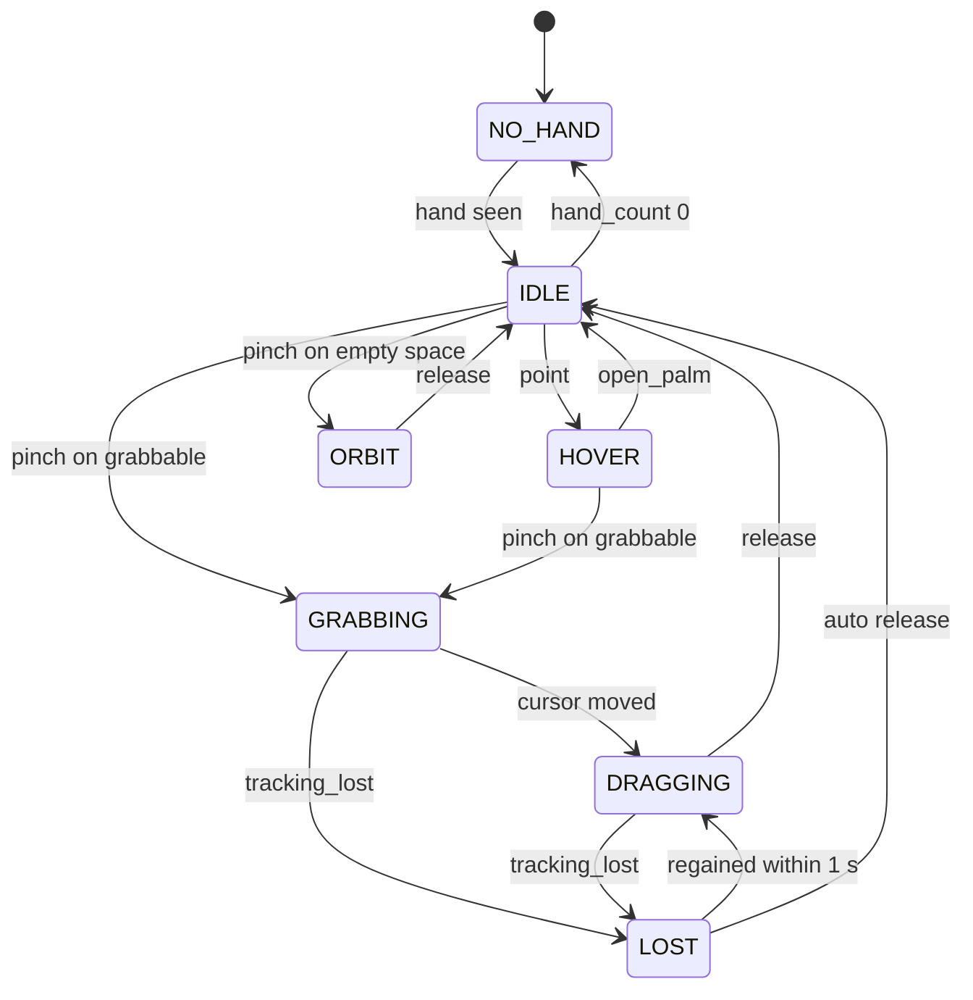
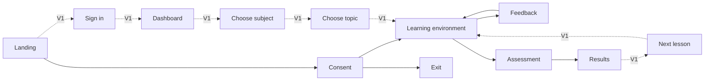

# UI/UX Architecture

This file defines how Grasp looks and, more importantly, how it makes gesture interaction legible: the learner must always know whether they are seen, what the system thinks their hand is doing, and what will happen on release. It covers the visual direction ("Heart studio", chosen by the user 2026-10-29) and its tokens, the nine considerations from the brief, the hand-state HUD, the major screens, feedback vocabulary, on-screen handling of the seven failure states, mouse and keyboard parity, and the accessibility baseline. Mostly **MVP**; dashboard and lesson map are **V1**.

One assumption in the brief is weak: "futuristic + premium" chrome competes with legibility when the learner is reading an instruction at arm's length while holding a pinch. The direction chosen here takes "premium" as a well-made museum specimen rather than sci-fi chrome: the heart supplies the visual interest, the HUD is warm, rounded, and quiet, and none of it covers the model. Where style and legibility conflict, legibility wins.

## Visual direction: Heart studio

The learning environment is a friendly anatomy textbook or museum specimen display. The heart sits on a cream plinth against a sage backdrop. Cream rounded cards hold the HUD, and buttons are chunky and pressable. The palette is sampled from `heart_v1`'s own textures: muscle maroon `#673a34`, fat gold `#ae8c46`, atria plum `#4e264f`. Sage is maroon's complement, so the dark model stands out. The source of truth is `mockups/lesson-restyle.html` (`data-theme="studio"`). The "lab" and "cozy" themes in that file were rejected. Where this doc departs from the mockup (copy, medals, game mechanics, contrast fixes), this doc wins. **MVP**.

| Option | Pros | Cons | Fit for solo dev | Verdict |
|---|---|---|---|---|
| Heart studio (light sage, cream cards, palette from the model) | The model's dark reds read strongly on sage; one warm theme across lesson and text screens; reads as educational, not as an LMS or a game | Light backdrop weakens emissive glow, so highlights need a new colour and keylines; gold and amber fail AA as text and need ink variants | High: tokens plus CSS, no new library | **MVP** |
| Previous flat dark theme (`#0B1020`, cyan accent) | Emissive highlights and ghost sockets glow; already partly built | Cold and generic; dark maroon heart muddy on navy; two themes to maintain | High | Retired; dark becomes a **V1** setting at most |
| Sci-fi lab (mockup "lab") | Strong futurism | Glow and scanlines compete with the instruction text; glow shadows cost paint | Medium | Rejected by user |
| Cozy cartoon (mockup "cozy") | Very approachable | Thick cartoon outlines clash with a realistic textured heart; reads younger than the target users | Medium | Rejected by user |

Checklist:

| Point | Note |
|---|---|
| Why appropriate | Derives colour from the content, so the model is always the strongest element on screen |
| Limitations | Light background halves the visual effect of emissive tints; gold and warn are text-unsafe on cream (see contrast table); the CSS plinth does not follow orbit |
| Performance | Tokens and backdrop are CSS behind a transparent canvas; no extra draw calls in MVP; compositing cost must be measured (see backdrop) |
| Accessibility | All text pairs verified at 4.5:1 or better below; states keep icon plus text; reduced motion stops all loops |
| Privacy | Fonts self-hosted at build time, so no request to Google at runtime |
| Scalability | Per-model palette is a token swap; a second model can sample its own palette into the same roles (**V1**) |
| Complexity | Low: one CSS file of custom properties, `next/font` for two fonts |
| Necessary? | The restyle is not needed to validate the learning loop; it was chosen for learner appeal. The simpler alternative is keeping the dark tokens. The cost is low, so it is accepted |

## Design principles

| Adjective from brief | Principle | What it rules out | Tier |
|---|---|---|---|
| Interactive | The model is the interface. Nothing important lives in a sidebar that could live on or near the model. | Form-heavy pages wrapped around a small viewport | **MVP** |
| Futuristic | Read as "a specimen you can take apart with your hand", not as sci-fi chrome. Motion and depth come from the scene: snap, cursor ring, socket ring, soft drift of the backdrop. | Glow, scanlines, glassmorphism stacks, sci-fi fonts | **MVP** |
| Educational | Every visual change answers a learner question: am I seen, what did I do, was it right, what next. Decoration is limited to the backdrop and never sits on the model. | Decorative particles over the model; animated mascots | **MVP** |
| Playful | Personality comes from shape, copy, and motion: pressable buttons, "Perfect fit!" on a correct snap, a static heart mascot on the remediation card. | Confetti on every success; cartoon tone in assessment | **MVP** |
| Premium | Few elements, cream cards with soft shadows, one accent colour (maroon) for every button, a serif display face, tabular numerals, no default browser widgets. Gold is a scene colour (sockets, highlight), never a button. | Badges and progress bars on every screen | **MVP** |
| Not a school LMS | No course-catalogue grids as the home experience; the dashboard (**V1**) is a lesson map, not a table of modules. | Breadcrumb trails, sidebar navigation trees | **MVP** |
| 3D-first, minimal HUD (kept) | HUD cards live in the edge gutters and the top band; the camera frames the model in the safe area between them. No HUD element overlaps the model at rest. | Centred panels during tasks (dialogs only appear for failure state 7 and the 15-minute prompt) | **MVP** |

## Design tokens

Tokens are CSS custom properties consumed by Tailwind's theme layer, so the same names drive DOM overlays and are read by the R3F scene (highlight colours, ring colours) through a tiny `tokens.ts` export. **MVP**.

| Option | Pros | Cons | Fit for solo dev | Verdict |
|---|---|---|---|---|
| CSS custom properties + Tailwind theme | One source of truth, theme switch is one attribute, trivial to read into Three.js | Tailwind class soup in HUD components if undisciplined | High | **MVP** |
| Component library theme (MUI, Chakra) | Many ready widgets | Heavy bundle competing with the 30 fps budget; looks like every admin tool | Medium | Reject |
| Styled-components / Emotion theme | Fine-grained | Runtime CSS-in-JS cost on every render; redundant with Tailwind | Medium | Reject |

Checklist: fits a small bespoke HUD; limitation is no widget library, so dialogs use headless Radix primitives; no performance or privacy cost; accessibility rests on the contrast values below; scales to any theme count; low complexity; plain CSS is simpler but loses shared naming with the 3D layer.

### Type scale

Fonts: **Fraunces** (display: headings, instruction line, buttons, level-path numbers) and **Inter** (body, chips, key caps, captions). Both are free Google Fonts under the SIL Open Font License. They are loaded with `next/font/google`, which downloads them at build time and serves them from the app, so the learner's browser never contacts Google. **MVP**.

| Option | Pros | Cons | Fit for solo dev | Verdict |
|---|---|---|---|---|
| `next/font/google`, self-hosted at build | No runtime third-party request (privacy, CSP stays same-origin); automatic subsetting and `font-display: swap`; no layout shift | Build needs network once; two families add about 60 to 90 KB of WOFF2 with Latin subsets | High | **MVP** |
| Google Fonts `<link>` (as in the mockup) | Zero setup | Every page view contacts Google: a privacy leak in a study; needs a CSP exception | High | Reject |
| System fonts only | Zero bytes | Loses the approved specimen look | High | Fallback stack only |

Limitations: Fraunces is a high-contrast serif and gets fussy below 16 px, so it is never used for `text-hud`, `text-caption`, or key caps. Inter supplies the tabular numerals (`font-variant-numeric: tabular-nums`) for timers and counts. No accessibility cost when sizes below are respected.

| Token | Family | Size / line height | Use |
|---|---|---|---|
| `text-display` | Fraunces 800 | 40 / 48 | Landing headline, results heading, "Perfect fit!" burst (54 / 56) |
| `text-h1` | Fraunces 700 | 28 / 36 | Screen titles, dialog titles |
| `text-instruction` | Fraunces 700 | 22 / 28 | The instruction line in the mission card |
| `text-button` | Fraunces 700 | 17 / 22 | Buttons |
| `text-body` | Inter 400 | 16 / 24 | Narration cards, hint card, tutor messages, dashboard |
| `text-hud` | Inter 600 | 14 / 20, +2% tracking | Chips, labels, key caps, tries text |
| `text-caption` | Inter 400 | 13 / 18 | Timestamps, legal, consent footnotes |

### Colour roles

Semantic roles, not palette names. One theme, `studio`, applies to every screen in **MVP**; this replaces the earlier dark-for-3D, light-for-text split. Tune on real monitors, but any change must keep the contrast table below passing.

| Role | Token value | Mockup name | Meaning and permitted use |
|---|---|---|---|
| `bg` | radial `#eef2ea` (centre) to `#c9d5c3` (edges) | `--bg2`, `--bg1` | Page and scene backdrop (sage) |
| `surface` | `#fbf8f1` | `--panel` | Cards, chips, pills, panels, dialogs |
| `surface-edge` | `#e4dccb` | `--panel-edge` | 1.5 px card keyline, dividers, "Keep practising" medal fill |
| `track` | `#d3cab5` | `#d3cab5` | Decorative edges only: ghost-button boundary, upcoming-node border. Never the sole carrier of meaning |
| `text` | `#3a1f2b` (plum) | `--ink` | Primary text; cursor ring; focus and dwell outline; keylines on the cursor ring (including the lost cursor) and the socket ring only |
| `text-muted` | `#6e5a62` | `--muted` | Secondary text on `surface` only; also graphics: `NO_HAND` dashed ring, unfilled hint level bars (1.5 px outline), unfilled tries pips, mastery-bar track outline |
| `accent` | `#8e3b3a` (maroon) | `--accent` | Every button, current level-path node, link text |
| `accent-ink` | `#fff8ef` | `--accent-ink` | Text on `accent` |
| `success` | `#4f8a5a` | `--ok` | Correct: icons, mastery bars, tracking dot. Not for small text |
| `success-ink` | `#3d6e47` | new | Correct as text, or as a fill under white text (done nodes, Mastered medal) |
| `partial` | `#b8862f` | `--warn` | Partial, attention: icons, filled hint level bars, doc 05's emissive tint on a partially placed part. Not for text |
| `warn-tracking` | `#b8862f` | `--warn` | Tracking lost, poor lighting: chip ring, dashed cursor (with `text` keyline). Not for text |
| `error` | `#b5523f` | `--bad` | Incorrect: icon and bar; text allowed (4.7:1) |
| `gold` | `#c9a14a` | `--gold` | Scene shapes only: socket ring, drop target, `highlight` tint. Never text, never a button |
| `amber-ink` | `#7d5f22` | new | Any text that would be gold or amber: hint card tag, mission tag, warn chip text |
| `highlight` | `gold` as emissive tint at low intensity | new | Hovered or hinted component in the scene; replaces the old `accent` tint, which vanishes on a maroon heart |
| `ghost` | `gold` at 15% (`rgba(201,161,74,.15)`) | `.12` to `.18` | Ghost socket fill |

Shape and elevation tokens:

| Token | Value | Use |
|---|---|---|
| `radius-card` | 18 px | Cards, chips, preview frame, dialogs |
| `radius-button` | 14 px | Buttons |
| `shadow-card` | `0 0 0 1.5px surface-edge, 0 10px 28px rgba(58,31,43,.16)` | Every card |
| `shadow-button` | `0 5px 0 #5e2224, 0 10px 18px rgba(94,34,36,.25)`; pressed: `translateY(4px)`, `0 1px 0 #5e2224` | Primary buttons (the 5 px bottom ledge is the "pressable" cue) |
| `shadow-button-ghost` | `0 0 0 2px track inset, 0 4px 0 track` | Secondary buttons on `surface` |
| `socket-ring` | 3 px dashed `gold` plus a 1.5 px solid `text` keyline outside it, `ghost` fill | Sockets and drop targets |
| `scene-dim` | Scene and backdrop dimmed to 60% under dialogs and failure-state cards (doc 02's value) | Failure state 1 card, remediation dialog, 15-minute prompt, results |

#### Verified contrast

WCAG 2.x relative-luminance ratios, computed from the hex values. Required: 4.5:1 for small text, 3:1 for large text (24 px, or 18.7 px bold) and for UI graphics.

| Foreground | Background | Ratio | Verdict and rule |
|---|---|---|---|
| `text` `#3a1f2b` | `surface` `#fbf8f1` | 14.0 | Pass |
| `text` | `bg` edge `#c9d5c3` | 9.8 | Pass; HUD text may sit on the backdrop |
| `text-muted` `#6e5a62` | `surface` | 6.0 | Pass, as text and as graphics (unfilled bars, pips, bar track) |
| `text-muted` | `bg` edge | 4.2 | **Fail** as small text: muted text only on `surface`. Passes 3:1 as a graphic, so the `NO_HAND` dashed ring may sit on sage |
| `accent-ink` `#fff8ef` on `accent` `#8e3b3a` | | 7.0 | Pass (white: 7.4) |
| `accent` as text | `surface` | 7.0 | Pass |
| `success` `#4f8a5a` as text | `surface` | 3.9 | **Fail** for small text: use `success-ink`. Passes 3:1 as a graphic (tracking dot on its `surface` pill, mastery bar) |
| white | `success` | 4.1 | **Fail**: done nodes and Mastered medal use `success-ink` fill |
| `success-ink` `#3d6e47` | `surface` | 5.6 | Pass (white on it: 6.0) |
| `success-ink` 54 px burst | `bg` centre / edge | 5.3 / 3.9 | Pass as large text; the mockup's `success` burst is 2.7 at the edge, so the burst uses `success-ink` |
| `partial` / `warn` `#b8862f` | `surface` | 3.1 | **Fail** for text; passes 3:1 for icons and filled bars, just |
| `partial` / `warn` | heart muscle `#673a34` | 2.9 | **Fail** as a graphic on the model, and a `text` keyline cannot fix it (`text` on muscle is 1.6). On the model the `partial` tint is a secondary cue; the HUD icon and text carry the meaning. The lost cursor sits on a `surface` fill, so its keyline works |
| `gold` `#c9a14a` | `surface` | 2.3 | **Fail** for text and for UI graphics on cream |
| `gold` | `bg` edge / centre | 1.6 / 2.1 | **Fail** as a graphic on sage: hence the `text` keyline on the socket ring |
| `gold` | heart muscle | 3.9 | Pass: the ring reads against the model |
| `#8f6f2c` (suggested in brief) | `surface` | 4.4 | **Fail**, just under 4.5; not used |
| `amber-ink` `#7d5f22` | `surface` | 5.6 | Pass; on `bg` centre 5.2, but 3.9 on `bg` edge, so only on `surface` |
| `text` | `surface-edge` (Keep practising medal) | 10.9 | Pass |
| `error` `#b5523f` | `surface` | 4.7 | Pass, narrowly (white on `error`: 4.9) |
| `surface` at 70% over muscle (cursor fill) | heart muscle | 5.3 | Pass; the `text` ring alone on the heart is only 1.6, so the cream fill is mandatory |
| `track` `#d3cab5` | `surface` | 1.5 | Decorative only (ghost-button boundary, upcoming-node border); the label or number identifies the element, as WCAG 1.4.11 allows |

The high-contrast variant replaces every `track` boundary with a 2 px `text` border.

#### High-contrast variant

Triggered by the user setting or `prefers-contrast: more`. Values: `bg` and `surface` become `#ffffff` and `text` becomes `#000000` (21:1). `accent` becomes `#5e2224` with white text (12.1:1). Shadows are replaced by 2 px `text` borders, and the socket ring is solid 3 px `text`. Every DOM state gets a 3 px outline. The plinth and blood cells are hidden. In the scene, **MVP** keeps doc 05's emissive tints (`highlight`, `partial`) and relies on the `text`-keyline cursor and socket ring, plus the HUD icon and text for every outcome. Component outlines, solid or dashed, need post-processing, which [05](05-3d-interaction.md) makes **V1**, so it is **V1** here too. Colour is never the sole carrier of meaning (see feedback vocabulary).

### Backdrop: sage, plinth, blood cells

The backdrop sets the specimen-display mood and must stay cheap. Inference p95 has been seen at 43.8 ms against a 33 ms budget. That is an open risk from prototype milestone M11, which was not validly measured, so there is no trustworthy baseline yet (budget per [05](05-3d-interaction.md) and [15](15-risks-security-scalability.md)). The figure-8 circulation loop from an earlier mockup was removed by the user and is not part of the design.

| Option | Pros | Cons | Fit for solo dev | Verdict |
|---|---|---|---|---|
| CSS layer behind a transparent canvas: gradient, one plinth ellipse, at most four blood-cell discs | No draw calls; loops run on the compositor with `transform` only; trivially disabled for reduced motion and high contrast | Plinth is fixed in screen space, so it does not tilt with orbit or follow `cameraTo`; the canvas must clear transparent; compositing a transparent canvas over animated layers has a cost, small but unmeasured | High | **MVP** |
| Low-poly meshes in the R3F scene (plinth cylinder, 3 to 4 instanced discs) | Plinth follows orbit and perspective; cells could sit in depth | Animated cells force the demand frameloop to render every frame, which is exactly the budget at risk; extra draw calls | Medium | **V1**, only after a perf check |
| HDR environment, post-processing (bloom, depth of field), extra lights | Richer studio lighting | Breaks the [05 renderer rules](05-3d-interaction.md) (one directional plus one hemisphere light, no post-processing); highest GPU cost | Low | Reject |

Checklist for the recommended CSS layer:

| Point | Note |
|---|---|
| Why appropriate | Gives the approved look without touching the render loop |
| Limitations | Static plinth under orbit and exploded poses; cells are decoration |
| Performance | No draw calls; compositor work for four `transform` loops and an alpha canvas; must pass the on/off measurement below |
| Accessibility | `aria-hidden`; loops stop under reduced motion; hidden in high contrast |
| Privacy | None |
| Scalability | Per-model backdrop is a CSS swap |
| Complexity | About 30 lines of CSS |
| Necessary? | No. The simpler alternative is the plain sage gradient alone, which is the fallback if the measurement shows any regression |

MVP rules:

| Element | Spec | Tier |
|---|---|---|
| Canvas | Clears transparent (`alpha: true`, no `scene.background`), so the CSS backdrop shows through. No extra lights beyond doc 05; no post-processing. Doc 05 owns the change, and also owns light intensity (raised 2026-10-29 so the heart reads on the light backdrop) | **MVP** |
| Sage gradient | Page background on the lesson route, radial `bg` | **MVP** |
| Plinth | One CSS ellipse centred 85% from the top, under the model's rest position (the model sits a little below centre, `VIEW_LIFT` in [05](05-3d-interaction.md)), cream radial gradient with a soft plum shadow. It is placed for the default pose; exploded poses may overhang it, which is accepted | **MVP** |
| Blood cells | At most four CSS discs (22 to 56 px, maroon radial gradient, 85% opacity) in the outer gutters, never behind the model or a HUD card. 7 s vertical bob, `transform` only. No CSS `filter: blur` (the mockup's 0.6 px blur forces repaint; use a soft gradient edge). `aria-hidden` | **MVP** |
| Pre-pilot measurement | Before the pilot, on the reference device in one session, run the same lesson three times with the blood cells on and three times off, and compare the medians of render frame time p95 and inference p95. A regression is either p95 rising by more than 2 ms or 5%, whichever is larger. On a regression, the cells ship off in pilot and study sessions (same wording in [05](05-3d-interaction.md) and [13](13-roadmap.md)) | **MVP** |
| Any 3D version of plinth or cells | Same measurement and regression threshold; it ships only with no regression | **V1** |

Limitation: the blood cells are pure decoration. They are allowed only because they sit in the gutters, add no draw calls, and stop under reduced motion. If the pilot shows them distracting (gaze or time on task), they are cut.

### Motion rules

| Token | Duration / easing | Use | Tier |
|---|---|---|---|
| `motion-micro` | 120 ms ease-out | Chip state change, cursor glyph swap, button press | **MVP** |
| `motion-standard` | 200 ms ease-out-cubic | Panels, cards, labels | **MVP** |
| `motion-snap` | 150 ms ease-out | Component snapping into a socket, matches [3D interaction](05-3d-interaction.md) | **MVP** |
| `motion-pop` | 500 ms `cubic-bezier(.2,1.6,.4,1)` | "Perfect fit!" burst entry; four small sparks fade over 900 ms | **MVP** |
| `motion-reset` | 400 ms ease-in-out | Scene reset tween | **MVP** |
| `motion-dwell` | 600 ms linear | Dwell ring fill; functional, not decorative | **MVP** |
| `motion-pulse` | 1 s loop (1 Hz), 0.6 to 1.0 opacity; runs 3 s then stops | Hint highlight, Hint button, in-range socket ring (for as long as in range); "looking for hand" chip loops until a hand is seen | **MVP** |
| `motion-drift` | 7 s ease-in-out loop, 14 px | Backdrop blood cells only | **MVP** |
| `motion-turntable` | 12°/s constant yaw | `introduction` ("Meet the heart") only: the heart turns slowly until the learner grabs, turns, or zooms, then stops for the rest of the activity. If the learner never takes over, the camera returns to the front view when the activity ends. It runs while the camera is on, so it is part of the pre-pilot measurement (details in [05](05-3d-interaction.md)). Separate from the landing-page idle rotation, which stops before the camera starts | **MVP** |

The socket ring is static until a dragged component is within snap range. Only then does it pulse, because the scene is already rendering every frame during a drag. A permanently pulsing 3D ring would defeat the demand frameloop. This differs from the mockup, where the ring pulses all the time. In `assessment` (`socketVisual: "none"`, per [05](05-3d-interaction.md)) there is no in-range cue at all: no ring, no pulse, no label.

Reduced motion (`prefers-reduced-motion` or setting): all loops stop (blood-cell drift, socket pulse, chip pulse, Hint button pulse), and the introduction turntable is off. The burst appears without the pop or sparks. Snaps and resets become instant with a 100 ms fade, panels fade instead of sliding, and pose changes cross-fade. The dwell ring still fills because it communicates progress toward a commit. Limitation: instant snapping loses the "landing" cue, so the success icon and text are mandatory.

## The nine considerations

| # | Consideration | Decision | Tier |
|---|---|---|---|
| 1 | 3D-first interface | Full-bleed canvas over the sage backdrop; during a task the only 2D elements are the HUD cards in the gutters, the hand-state chip, and the camera preview. Selection screens show the model, not text thumbnails. | **MVP** |
| 2 | Dark/light themes | One light theme, Heart studio, on every screen in MVP; it replaces the earlier dark learning environment. The light backdrop is why highlights use `gold` and the socket ring has a `text` keyline. A dark variant is a **V1** setting at most. High contrast is **MVP**. `data-theme` attribute. | **MVP** studio and high contrast, **V1** dark setting |
| 3 | Spatial UI | Component names and the "release to place here" cue are billboarded Drei `<Html>` anchored in 3D; a hotspot label is one DOM label positioned over the projected marker on hover or focus ([05 §3.7](05-3d-interaction.md)). Names appear only in `introduction` and `explore` (see "No answers on hover"). Rule: spatial if it refers to a point in the scene, overlay if it refers to the session. Spatial labels are `surface` pills with `text`. | **MVP** |
| 4 | Progress visualisation | In-task: the level path (one node per activity) plus "Task n of m" in the mission card tag. Post-lesson: per-objective mastery bars and band medals with the objective statement. XP and badges are **V1**, per [gamification](08-gamification.md). | **MVP** path, bars, medals; **V1** XP, badges, history |
| 5 | Interactive lesson maps | Node graph of lessons per subject with the topic's model as node art, in the same node style as the level path; locked nodes dimmed with the prerequisite named. Replaces the LMS course list. | **V1** |
| 6 | Floating contextual controls | Appear beside the hovered component on `point` hover or via a "..." button: Inspect, Reset this part, Ask tutor about this (**V1**, free text). Inspect turns the model to face the selected component (`cameraTo`, keeps the camera distance) and shows its manifest description in `explore` and `guided` activities; it shows the component's hotspots only in `explore`, never in `guided`, because hotspot labels name parts; it serves the `identify` objective by letting the learner compare look-alike parts before answering. Nothing floats during `pinch_drag`. | **MVP** inspect and reset, **V1** ask tutor |
| 7 | Minimal HUD | Hard cap during tasks: level path, mission card, Hint button (with the hint card when opened), hand-state chip, camera preview, controls guide. Narration cards only in introduction. Nothing overlaps the model at rest. | **MVP** |
| 8 | Clear feedback | Every outcome pairs colour + icon + motion + one line of text, and the scene reacts (snap, shrug, tint). See feedback vocabulary. | **MVP** |
| 9 | Large visual interaction cues | Cursor ring 28 px, dwell ring 36 px, socket rings at least 48 px on screen, hover labels in `text-instruction`, DOM hit targets 44 px minimum (buttons are 52 px tall). | **MVP** |

## Hand-state HUD

The HUD mirrors the [gesture state machine](04-computer-vision.md#gesture-state-machine) in computer vision one-to-one, so the learner never guesses what the system believes. It is a DOM overlay because text, focus, and screen-reader announcement are free in the DOM and expensive in WebGL.

| Option | Pros | Cons | Fit for solo dev | Verdict |
|---|---|---|---|---|
| DOM overlay (absolute-positioned React) | Crisp text, CSS tokens, `aria-live`, focusable, zero GPU cost | Must sync cursor position per frame via a ref, not React state | High | **MVP** |
| Drei `<Html>` for everything | One mental model | Each `<Html>` re-projects every frame; dozens of them hurt the 30 fps budget | Medium | Component name labels only; hotspot labels are one projected DOM label |
| In-canvas sprites / troika text | Consistent depth, no DOM | Poor accessibility, hard text, more code | Low | Reject |

### States and what the learner sees

The diagram shows HUD display states. All but one map to the gesture FSM in doc 04; `ORBIT` is HUD-derived, not a gesture-FSM state: it is `DRAGGING` combined with `orbit.active` reported by the scene when the `pinch` landed on empty space.



The cursor is a `text` (plum) ring with a `surface` 70% fill in every state. The fill carries the contrast over the dark model (5.3:1) and the ring carries it over sage. The chip is a `surface` pill in the left gutter above the camera preview.

| FSM state | Detection chip | Gesture glyph | Cursor | Scene |
|---|---|---|---|---|
| `NO_HAND` | `text-muted` dashed pulsing ring, "Looking for your hand" | None | Hidden | Unchanged; after 3 s see failure state 1 |
| `IDLE` (`open_palm`) | `success` dot, "Hand seen" | Open palm | 28 px hollow ring at smoothed cursor | No highlight; palm never selects |
| `HOVER` (`point`) | `success` dot, "Pointing" | Index finger | Ring shrinks to 20 px with centre dot; over a component a 36 px dwell ring fills in `text` over a 4 px `surface` track in 600 ms | Hovered component tinted `highlight`. Name label billboarded above it only in `introduction` and `explore`; in graded activities highlight only |
| `GRABBING` (`pinch`) | `success` dot, "Pinching" | Pinch | Filled 20 px `surface` disc with `text` ring | Component lifts 2% scale, short `text` tether line from cursor to component |
| `DRAGGING` (`pinch_drag`) | `success` dot, "Moving" | Pinch with motion arrows | Filled disc | Component follows on drag plane; nearest socket within 1.5× radius pulses and shows "Release to place here"; otherwise cursor label "Release to drop" |
| `ORBIT` (HUD-derived: `DRAGGING` + scene `orbit.active`) | `success` dot, "Turning the model" | Pinch with orbit arrows | Disc with orbit arcs | Faint `text` horizon ring under the model so rotation is readable |
| `LOST` | `warn-tracking` ring with 1 s countdown arc, "Lost your hand" in `amber-ink` | Last glyph, dimmed | `warn-tracking` dashed ring with a `text` keyline, frozen at last position | Held component freezes in place, tinted `warn-tracking` (doc 05 emissive tint); the chip icon and text carry the meaning. A dashed component outline is **V1** |

Dev sessions only (`extraGestures`, never under `studyParity`, never logged): four more HandState values drive the chip and the controls guide highlight: `FIST` "Spinning the model", `ZOOM` "Zooming", `EXPLODE` "Exploding", `ROLL` "Rolling the model". They are not in the diagram above because study sessions never reach them. **V1**; built outside the study (dev only).

While `cv_status` is `low_confidence` the glyph dims to 50% without changing state, which warns the learner before a drop happens. Doc 04 owns the single presence floor of 0.6; the HUD does not apply its own threshold.

### No answers on hover

A component's name is the answer to `identify`, `compare`, and `sequence` tasks, so it must not leak before a commit. **MVP**.

| Activity | Pointer or `point` hover | Keyboard focus (visible pill and screen-reader announcement) |
|---|---|---|
| `introduction`, `explore` | `highlight` tint plus name label | Manifest name and description |
| `guided`, `challenge`, `assessment` | `highlight` tint only, no name | "Part n of m" in manifest order. Built: in graded activities the scene never speaks a part's name or socket; Tab says "Part n of m", and grab, let-go, place, and drop announcements say "part …" with no socket id (`packages/scene` `lesson-scene.tsx`, `graded()`) |

After a commit, an incorrect outcome still shows the chosen part's real name for 2 s (feedback vocabulary); that is feedback on a finished attempt, not a hint.

### Pre-commit states

Every action that the learning engine will evaluate has a visible pre-commit state, so a wrong gesture or wrong target is caught before it counts as an attempt.

| Learner intent | Pre-commit (reversible) | Commit | Cancel |
|---|---|---|---|
| Select for `identify`, `compare`, `sequence` | `point` over component: highlight (name label only in `introduction` and `explore`), dwell ring filling | Ring full at 600 ms, or `pinch` on the component, emits `select` | Move off before fill; ring empties over 120 ms |
| Grab for `place`, `remove` | `pinch` held 2 frames over grabbable: lift and tether | `grab_start` (not evaluated; nothing scored until drop) | Release before moving: component settles back, no attempt logged |
| Drop into socket | While dragging within 1.5× socket radius: the dashed gold ring pulses, label "Release to place here", ghost preview of final pose in guided activities | `release` emits `place`; snap 150 ms; engine evaluates | Drag away: ring stops pulsing, label reverts to "Release to drop" |
| Orbit | `pinch` on empty space: orbit glyph, horizon ring | Immediate; orbit is never evaluated | Release |

In challenge activities the socket cue shows for any socket in range, correct or not: the learner sees where the part will go, never whether it is right. In assessment (`socketVisual: "none"`) there is no in-range cue at all: no label, no ring, no pulse; the cursor label stays "Release to drop".

Implementation rule: socket-range transitions during a drag (the label switching between "Release to place here" and "Release to drop", ring pulse on and off) update through refs or imperative DOM and material writes, never React state. Acceptance A9 requires zero React commits during a drag. **MVP**.

### Camera preview and tracking-active indicator

Required by [research-protocol](../.claude/skills/research-protocol/SKILL.md) ethics rules: participants can see the camera preview at all times and a visible indicator when tracking is active.

| Element | Spec | Tier |
|---|---|---|
| Preview | 256×144, mirrored, bottom-left, in a `surface` card frame (`radius-card`, 6 px inset), 80% opacity until hovered (enlarged from 160×90 so the landmark overlay is readable at arm's length) | **MVP** |
| Hand overlay | The 21 hand landmarks drawn over the mirrored video (bones in teal, points in yellow) plus the smoothed cursor dot, so the learner sees what is tracked and where the system places their hand. The worker posts landmarks to the preview only when it asks for them (`showHands`); each frame is drawn and dropped and never reaches the lesson, the logger, or the network ([04](04-computer-vision.md)). Limitation: the overlay colours are fixed, not tokens, and have no high-contrast variant | **MVP** |
| Tracking-active label | `surface` pill in the preview's top-left corner with a `success` dot and "Tracking" in `text` whenever frames are processed; `text-muted` dot and "Paused" otherwise | **MVP** |
| Toggle | Collapses to a 32 px chip that keeps the tracking dot; minimisable, never removable, while tracking | **MVP** |
| Camera off | Preview button or `Esc, Esc`; stops the stream at once, chip shows `error` slash icon and "Camera off", mouse mode offered | **MVP** |
| Expanded preview | 384×216 at full opacity with silhouette guide; opened by failure states 1 and 2 | **MVP** |

### Learning environment wireframe

```text
+----------------------------------------------------------------------------+
|                 ( 1 )-( 2 )-[ 3 ]-( 4 )-( 5 )-( 6 )  Build the heart        |
|                                                      Stage 3 of 6           |
| +----------------------------+                         [ Hint ]  2 left     |
| | TASK 2 OF 4                |                    +------------------------+|
| | Put the left ventricle back|                    | HINT 1 OF 3  ===  [ ]  ||
| | Pinch it, carry it to the  |                    | It is the thickest ... ||
| | ring, and let go.  o o .   |                    +------------------------+|
| +----------------------------+       ( 3D heart )                           |
|      .                                  (  ) <- dashed gold socket ring     |
|                                    o <- cursor ring       [ Continue -> ]   |
|                         _____________________________                        |
| [ * Hand seen ]        (      cream plinth (CSS)     )               .      |
| +-----------+                                                               |
| | preview   |     [ point hold: pick  pinch: grab  pinch empty: turn ]      |
| | * Track   |                                                               |
| +-----------+                                                               |
+----------------------------------------------------------------------------+
```

Placement rule: cards occupy the left and right gutters (about 350 px each at 1280 px wide) and the top band (about 72 px). The camera frames the model in the remaining safe area. Below 1280 px wide, the mission card collapses to its instruction line and the hint card opens over the right gutter only. The `.` marks are where backdrop blood cells may sit.

The controls guide is the parity surface described later. As built (2026-10-30) it is a card in the bottom-right corner, not the bottom-centre strip drawn above; it shows gesture glyphs in gesture mode and mouse/keyboard equivalents in mouse mode, and stays at full opacity (no fade).

The `[ Continue -> ]` side button shows only in activities that end on the learner's word (`introduction`, `explore`); see the components table.

## Major screens

Brief stages "3D Exploration", "Interactive Tasks", and "Computer Vision Interaction" are modes of the learning environment, not screens; they map to activity kinds `explore`, `guided`/`challenge`, and the hand-state HUD respectively.



All screens use the studio theme. Text-heavy screens (landing copy, consent) put a single wide `surface` card on the sage backdrop, with no plinth and no blood cells.

| Screen | Purpose | Key elements | States | Tier |
|---|---|---|---|---|
| Landing | Start the heart lesson in one click; set webcam expectations | Fraunces headline, idle-rotating heart on the plinth (same GLB, demand frameloop; rotation stops before the camera starts, so it never competes with the first inference frames), "Start the heart lesson" (`accent` button), camera explainer using the consent skeleton's privacy sentences, "Use mouse instead" (ghost button) | Default; camera denied (routes to mouse mode); unsupported browser | **MVP** |
| Consent | Record informed consent before the camera is ever requested ([14](14-evaluation-methodology.md), `research-protocol` consent skeleton) | Single `surface` card, single column; versioned consent text with its version shown; required "I have read the above and agree to take part" checkbox; separate, unticked, optional event-log checkbox ("no video or images"); session code field entered by the researcher (encodes phase and condition); "I agree, start" (`accent`, disabled until the agree box is ticked) and "I do not agree" (ghost) | Default; starting; invalid code ("not valid, ask the researcher"); code already used; database unavailable ("consent could not be recorded, so the lesson cannot start"); declined: plain "Thank you" exit screen stating nothing was recorded. The lesson redirects here when the session has no consent | **MVP** |
| Sign in | Optional account for cross-session progress | Email magic link, "Continue as guest", consent checkbox for study participants | Guest; signed in; study participant with condition locked | **V1** |
| Dashboard | Show where the learner is across lessons | Lesson map, mastery per objective, resume button, settings entry | Empty; in progress; all complete | **V1** |
| Choose subject | Pick a domain | Large cards with the subject's hero model rotating, lesson count, estimated time | One subject (anatomy) in V1 | **V1** |
| Choose topic | Pick a lesson inside a subject | Lesson map filtered to the subject; prerequisites drawn as edges; locked nodes name the missing prerequisite | Locked; available; mastered | **V1** |
| Learning environment | Run the lesson | Full-bleed canvas over the studio backdrop, level path, mission card, Hint button and hint card, hand-state chip, camera preview, controls guide, collapsed tutor panel | Per activity kind: `introduction` ("Meet the heart": `motion-turntable` until the learner grabs, turns, or zooms; orbit, cards), `explore` (hotspots), `guided` (ghost sockets, hints), `challenge` (ring sockets), `assessment` (no sockets, no hints); paused; tracking lost | **MVP** |
| Feedback | Tell the learner the outcome of one attempt without leaving the scene | Correct: "Perfect fit!" burst plus a sub-line card. Partial and incorrect: a feedback card under the mission card. Scene reaction, next-hint affordance, tutor explanation on request | correct, partial, incorrect, hint shown, tracking lost (vocabulary below) | **MVP** |
| Assessment | Same environment with stricter rules | Attempt counter "1 attempt" in the mission card, no Hint button, no ghost or ring sockets and no in-range cue, neutral feedback ("Recorded."), never a burst, not even when the activity ends (outcomes appear only on results); level-path node labelled "Final check" with a clipboard glyph | In progress; complete | **MVP** |
| Score / Progress (Results) | Show mastery per objective and what to do next | `surface` dialog over the scene at `scene-dim`: "Lesson complete!" heading; one row per objective with the objective statement, a band medal, and a mastery bar; list of missed tasks (skipped or never correct) under "Review"; participant code in Fraunces with "Write it down: quote it to the researcher to see or delete your data"; "Download event log" only when the participant consented to the event log (otherwise no log leaves the page, not even as a download); a next-lesson line driven by the unlock rule (`isLessonMastered`, [06](06-learning-engine.md)): "Every objective is mastered, so the next lesson is unlocked. Next lesson coming soon." or "Master every objective above to unlock the next lesson. Next lesson coming soon." Dev sessions only: "Review the parts you missed" (`accent` button: hides the results card and pulses the components behind each missed task, re-pulsing every 4 s because one hint pulse lasts 3 s; "← Back to results" on the right, in the Continue button's placement, brings the card back) and "Try again" (a fresh session with the same consent); both are hidden in pilot and study sessions, where post-lesson practice would contaminate the post-test ([06](06-learning-engine.md)). No stars, no XP, no badges in MVP | All mastered; some below threshold; study mode (routes to questionnaire); dev session; reviewing (dev only: card hidden, missed parts pulsing) | **MVP** |
| Results: XP line and badges | Smaller, below the medals | Per [08](08-gamification.md); hidden in study sessions | n/a | **V1** |
| Next lesson | Route onward | Next unlocked lesson card, or the prerequisite to repeat. MVP shows the next-lesson line on the results screen instead | Unlocked; locked | **V1** |

Results medals restate the mastery bands of [08 mastery levels](08-gamification.md#mastery-levels) and add no rule. Each is a pill with an icon and a word, never colour alone:

| Band (doc 08) | Condition | Pill | Tier |
|---|---|---|---|
| Not started | no attempts on the objective's tasks | `surface` fill, dashed `text-muted` border, dash icon, "Not started" in `text-muted` | **MVP** |
| Developing | mastery < 0.5 | `surface-edge` fill, circular-arrow icon, "Keep practising" in `text` | **MVP** |
| Approaching | 0.5 ≤ mastery < `masteryThreshold` | `surface` fill, 2 px `partial` border, half-circle icon, "Nearly there" in `text` | **MVP** |
| Mastered | mastery ≥ `masteryThreshold` | `success-ink` fill, check icon, "Mastered" in white (doc 08's "green"; the mockup's gold pill is not used) | **MVP** |

## Components inside the learning environment

| Component | Role | Shows | Tier |
|---|---|---|---|
| Scene canvas | R3F scene with model, sockets, hotspots; clears transparent over the CSS backdrop | Per [3D interaction](05-3d-interaction.md) | **MVP** |
| Level path | Position in the lesson; replaces the progress chip | `surface` pill at top centre: one 34 px node per activity in lesson order joined by short links. Done: `success-ink` fill, white check. Current: 44 px `accent` fill, `accent-ink` number, 2 px `surface` gap plus 2 px `accent` ring. Upcoming: `surface` fill, `track` border, `text-muted` number. Shape differs per state (check, size, ring), not only colour. Label beside it: activity title (Fraunces) and "Stage n of m". `nav` with `aria-label="Lesson progress"`, `aria-current="step"` on the current node. Not clickable in MVP | **MVP** |
| Mission card | The task `prompt` from lesson JSON, verbatim; replaces the bare instruction line | `surface` card in the left gutter (330 px): tag in `amber-ink` caps with the activity kind and "Task n of m"; instruction in `text-instruction`, truncated with "more" at 90 characters; optional one-line sub-instruction in `text-muted`; tries pips when the task has `maxAttempts` | **MVP** |
| Tries pips | Remaining attempts from `maxAttempts` | Filled `accent` pip per remaining try, hollow `text-muted` ring per used try, plus the text "2 tries left". Hidden when the task has no `maxAttempts`; in assessment it reads "1 attempt". It restates an engine rule and is not a score | **MVP** |
| Hint button | Reveal the next hint level | Ghost button with a lightbulb icon and the label "Hint", right gutter, with "n hints left" below. Pulses for 3 s after an incorrect attempt or 15 s idle, then stops. Absent in assessment. Shows no cost text (see game mechanics not adopted) | **MVP** |
| Hint card | The current hint | `surface` card below the Hint button: tag "Hint 1 of 3" in `amber-ink`; three level bars (filled `partial`, unfilled as 1.5 px `text-muted` outlines); hint text in `text-body`. Filled versus hollow and the tag text carry the level, so colour is never the only cue | **MVP** |
| Feedback burst and card | One attempt outcome | See feedback vocabulary; auto-dismiss 4 s or on next action. After an incorrect or partial attempt in `guided` or `challenge`, the template tutor's `explain_mistake` text replaces the card text automatically (one `/api/tutor` call per attempt, static hint text on failure) and the card stays up 10 s or until the next action; `pointer-events: none`; `role="status"` | **MVP** |
| Hand-state chip | Detection and gesture | See HUD table | **MVP** |
| Cursor and dwell ring | Where the hand is and what is about to commit | Per HUD table | **MVP** |
| Camera preview | What the system sees | Mirrored video with hand-landmark overlay, cursor dot, and tracking label | **MVP** |
| Continue button | Ends an activity that has no tasks | `btn` (48 px min height, over the 44 px target) beside the level path, top centre, clear of the model (moved from the right edge by user decision 2026-10-30): "Continue →" in `introduction`, "Start the lesson →" in `explore`. These activities end only on this button, not on a timer, so a slow reader is never moved on. Hidden while the remediation card or the 15-minute prompt shows. Reachable by click, keyboard, hand dwell, or pinch | **MVP** |
| Controls guide (`gesture-guide.tsx`; replaced the bottom-centre controls strip 2026-10-30) | Input parity | `card` in the bottom-right corner, clear of the model. One row per control: glyph (emoji in gesture mode; key cap in mouse mode, Inter 600 on a 1 px `track` border), verb in Fraunces bold, short "how" line in `text-muted`. Gesture mode: Pick, Grab, Turn, Let go. Mouse mode: Select, Move, Turn, Let go ("Release" key cap, "the mouse button"). Dev sessions only: an "Extras (dev)" group to the right behind a vertical rule (gesture: Spin (fist), Zoom, Explode, Roll; mouse: Wheel or + / − to zoom, X to explode); study sessions show one column, since zoom and X are off under `studyParity`. Gesture mode only: the row for the current HandState (same source as the hand-state chip) fills `accent` with `accent-ink` text and carries `aria-current`, so the highlight is not colour-only to assistive tech. The dev "Use the mouse / camera" link sits under the groups. Same component in both conditions, showing the same four actions; only the glyphs, key caps and the gesture-mode live highlight differ | **MVP**; Extras (dev) gesture rows **V1**, built outside the study; mouse extras (wheel / + −, X) are MVP capabilities off under `studyParity` ([05 §3.3](05-3d-interaction.md)) |
| Spatial labels | Component names and hotspot titles | Component names: billboarded `<Html>`, one at a time on hover, only in `introduction` and `explore`. Hotspot titles: one DOM label positioned over the projected marker on hover or focus ([05 §3.7](05-3d-interaction.md)), only in `introduction` and `explore`. Both are `surface` pills with `text`. Neither ever shows in `guided`, `challenge` or `assessment`, because a name gives the answer away | **MVP** |
| Floating contextual controls | Per-component actions | Inspect (turns the model to face the component via `cameraTo`, keeps the camera distance; shows the description in `explore` and `guided`, hotspots only in `explore`), Reset this part; Ask tutor about this (free text, never in MVP) | **MVP** inspect and reset, **V1** ask tutor |
| Narration cards | Introduction text | Shown in the mission card position while the heart turns on `motion-turntable` (stops for good once the learner grabs, turns, or zooms; off under reduced motion); one card at a time, max 220 characters; cards advance on their own every 7 s and stop at the last card (the activity itself ends only on the Continue button); auto-advance pauses while the pointer or the hand cursor is over the instruction panel; a Next button advances early and a Back button revisits the previous card, each by click, Enter, or hand dwell on the button | **MVP** |
| Remediation dialog | Failure state 7 | Centred `surface` dialog over the scene at `scene-dim`: static heart mascot (72 px SVG, `accent` fill, `text` stroke, `aria-hidden`, no animation), with doc 02's copy: title "Let's look at this together", body "No points this time, and that is fine.", buttons "Show me" (`accent`), "Try once more" and "Skip for now" (ghost). The mascot appears only here | **MVP** |
| Tutor panel | Messages from the template tutor ([07](07-ai-tutor.md)), phrased from the hint ladder and manifest data | No separate panel in MVP: mistake explanations appear automatically in the feedback card (see above), and a requested hint's tutor text appears in the hint card. Labelled as explaining, not grading. No "Explain" pill (dropped 2026-10-30: with one tutor call per attempt, a pill could only replay the static hint). Free-text "Ask tutor" panel is **V1** | **MVP** automatic text in feedback and hint cards, **V1** free-text panel |
| Pause overlay | Stop tracking and time | Resume, restart task, switch to mouse, leave | **MVP** |
| Settings sheet | Accessibility and privacy | Theme, motion, contrast, dwell 400 to 1200 ms, preview size, camera off, export or delete log | **MVP** motion, contrast, dwell, camera; **V1** rest |

## Feedback vocabulary

Every row is colour + icon + motion + text. Sound is optional, off by default, and never the only channel.

| Outcome | Colour | Icon | Motion | Scene reaction | Text template | Reduced motion | Tier |
|---|---|---|---|---|---|---|---|
| correct | `success-ink` | Check in circle | Burst headline pops in 500 ms (`motion-pop`) above the model's top silhouette with four small sparks, and a sub-line card below it; component flashes `success` tint once | Snap 150 ms into socket, or selected component holds highlight 600 ms | Headline: "Perfect fit!" for `place`, "That's it!" for `identify`, `compare`, `sequence`. Sub-line: "Correct. The aorta leaves the left ventricle." (prompt-specific line from lesson text or the template tutor) | Burst fades in; no pop, no sparks, no flash; tint held | **MVP** |
| partial | `partial` bar and icon; text in `text` | Half-filled circle | Feedback card slides in under the mission card; component wobbles 2 degrees twice | Component snaps to the wrong socket and keeps doc 05's emissive `partial` tint; the HUD flags it with the half-circle icon and text (a dashed component outline is **V1**) | "Right part, wrong place. Try another spot." | Fade; tint held, no wobble | **MVP** |
| incorrect | `error` bar and icon; text in `text` | Cross in circle, never a large red X | Feedback card slides in; component "shrugs" 1 degree once | Selected component shows its real name for 2 s: "That is the right ventricle" | "Not this one. Look for the left ventricle." | Fade; name label still shown | **MVP** |
| hint shown | `partial` level bars, `amber-ink` tag | Lightbulb | Hint card slides in; hinted components pulse at 1 Hz for 3 s; camera eases to `cameraTo` over 600 ms | Highlight per hint `highlight` array, tinted `highlight` | Hint `text`, tagged "Hint 2 of 3" | Static highlight for 3 s; camera cut | **MVP** |
| tracking lost | `warn-tracking` ring, `amber-ink` text | Hand with dashed outline | Chip arc counts down 1 s | Held component frozen, tinted `warn-tracking` | "Lost your hand. Hold still." then "The part was put down where it was." | Same, arc replaced by "1 s" text | **MVP** |

Partial and incorrect never get a burst. The asymmetry is deliberate: success is celebrated, and a mistake gets a calm card.

Assessment overrides: correct, partial, and incorrect all render as a neutral `text-muted` "Recorded" card with a clipboard icon and no burst, so the activity does not teach to the test; full outcomes appear on the results screen.

Known overlap: `accent` (maroon buttons) and `error` (red-brown) are close in hue. `error` is used only for the feedback icon, its bar, and the camera-off slash, always beside a cross icon and text, so a primary button is never read as an error.

## Game mechanics not adopted

The mockup contains elements that are game mechanics, not visual style. This doc does not adopt them. They belong to the learning-designer ([06](06-learning-engine.md), [08](08-gamification.md)). Until doc 06 or 08 decides, they stay out of the build and are never shown in pilot or study sessions, so that the two conditions differ only in input.

| Mockup element | Status here | Why |
|---|---|---|
| Three stars on results | Not adopted; open question for doc 06/08 | A star rating is a scoring rule on top of mastery |
| "Each costs a little score" under the Hint button | Display not adopted; open question for doc 06 | The cost itself already exists as engine policy (`hintPenalty`, 2 of 10 in the heart lesson, [06](06-learning-engine.md)). Only whether to *show* it is undecided: showing a cost may teach hint avoidance, which doc 06 warns against |
| XP or points during a task, XP and badges on results | Not in MVP | Doc 08 makes XP and badges **V1**, and study mode hides them |
| "· first try" suffix on the correct sub-line | Not adopted in MVP | Implies a score for first-try success; the attempt count is already on results |

Study parity: the whole visual restyle (theme, fonts, backdrop, burst, mascot, level path, medals) applies identically to the gesture and mouse conditions. What differs by condition is only what already differed: the controls guide's glyphs, key caps and live row highlight (gesture mode only; both conditions list the same four actions), the hand-state chip, the camera preview, the hand cursor and dwell ring, the dwell outline on HUD controls, and failure states 1, 2, and 5, which cannot occur in the mouse condition.

## Failure states on screen

Pedagogical response and learner-facing copy are owned by [learning experience](02-learning-experience.md); signals are owned by [computer vision](04-computer-vision.md). This table is the on-screen behaviour and adopts doc 02's copy and its 60% scene dim verbatim. The studio restyle changes only the cards, colours, and type of these states, not their triggers, timing, copy, or recovery.

| # | Failure | Trigger signal | What the learner sees | Recovery | Tier |
|---|---|---|---|---|---|
| 1 | Camera cannot detect learner | `hand_count 0` for 3 s with an active stream (10 s during introduction) | Scene dims to 60%; preview expands with a hand silhouette; `surface` card "Show me your hand. Palm toward the camera, about 40 cm away." | Hand seen 1 s: card and preview return. After 20 s: in a dev session "Trouble? Use the mouse instead"; in a pilot or study session "Still having trouble? Please call the researcher." instead, since the condition is fixed by the session code | **MVP** |
| 2 | Poor lighting | `cv_status: "low_confidence"`: mean presence confidence below 0.7 over 2 s while a hand is intermittently seen, or preview luminance out of band (thresholds owned by doc 04) | Preview expands with a light meter; "Hard to see your hand. Face a light or move away from the window." Chip in `warn-tracking` with `amber-ink` text | `cv_status` returns to `ok` for 1 s dismisses; 30 s persistent offers mouse mode outside study sessions; logged for the pilot | **MVP** |
| 3 | Incorrect gesture | Gesture does not match the task affordance: `point` dwell completing on a grabbable during a `place` task; `pinch` on a non-grabbable during `identify`; a grab released before the cursor moved (a false start, known only at `grab_end`; detected from `firstMoveMs` null, see [14 §2.1](14-evaluation-methodology.md#21-computer-vision-metrics)), the second on the same task | Cursor ring turns dashed; a `surface` pill with `text` label beside the cursor shows the expected gesture: "Pinch to grab" or "Point to select"; for a false start, "Pinch, then move", shown after release. Never an `error` colour; nothing is scored | Correct gesture clears it; a false-start label is cleared by the next grab that moves. Third occurrence on one task adds the glyph to the mission card | **MVP** |
| 4 | Wrong object | Engine returns incorrect on `identify`, `compare`, `sequence`, or partial on `place` | Incorrect or partial vocabulary; chosen component's real name shown 2 s; mission card stays; Hint button pulses for 3 s | Retry; hint level advances per [learning engine](06-learning-engine.md); a wrongly placed part stays snapped and flagged | **MVP** |
| 5 | Tracking lost mid-interaction | `tracking_lost` while `GRABBING` or `DRAGGING` | Chip `warn-tracking` with 1 s arc; cursor frozen as a dashed amber ring with `text` keyline; held component frozen and tinted `warn-tracking`; "Lost your hand. Hold still." | `tracking_regained` within 1 s: chip returns, drag continues, label "Welcome back". Otherwise auto-release to last valid position, never into a socket; text "The part was put down where it was."; no attempt logged | **MVP** |
| 6 | Learner confused | No interaction event for 15 s during a task; three or more hovers without a commit in 20 s; Hint button pressed | Hint button pulses for 3 s, mission card gains "Need a hint?" | Hint shown vocabulary; template `hint` on request; `explain_mistake` already shown automatically after each incorrect or partial attempt. Pedagogical escalation per 02 | **MVP** |
| 7 | Repeated failure | Attempts reach `maxAttempts`, or three incorrect on one task | Remediation dialog (components table) with the level-3 hint applied: static heart mascot, "Let's look at this together", "No points this time, and that is fine."; buttons "Show me" (guided animation), "Try once more", "Skip for now" | Show me replays the task unscored (reduced motion: static highlight, and the part jumps into the socket and back without a tween); Skip marks it incomplete and lists it under "Review" on results | **MVP** |

Failure states 1, 2, and 5 do not appear in mouse mode. Failure state 3 maps to "wrong input" in mouse mode (for example, clicking a non-grabbable during `place`) with the same cursor label pattern.

## Mouse and keyboard parity

The mouse condition in the study must feel first-class, and keyboard operation is the accessibility floor. Every gesture action has a mouse and keyboard equivalent. The controls guide shows the same four actions in both conditions (mouse key caps instead of gesture glyphs); keyboard keys are exposed only in the scene's aria-label. An input-mode switch sits under the guide's groups ("Use the mouse" / "Use the camera"); it appears only in dev sessions. In pilot and study sessions the condition is fixed by the session code and there is no switch.

| Action | Gesture | Mouse | Keyboard | Exposed where |
|---|---|---|---|---|
| Move cursor | `open_palm` | Pointer | Tab / Shift+Tab cycles interactable components in manifest order | No guide row; Tab in the scene aria-label |
| Hover and select | `point` + dwell or `pinch` | Hover highlights; click selects | Enter on focused component | Guide row Pick / Select; Enter in the scene aria-label; the focus pill shows "Enter" with the name in `introduction` and `explore`, "Part n of m" otherwise |
| Grab | `pinch` on grabbable | Mouse down on component | Space on focused grabbable (picks up) | Guide row Grab / Move; Space in the scene aria-label |
| Move | `pinch_drag` | Drag | Arrow keys move 0.5 units on the drag plane; Shift for 2 units; PageUp/PageDown for z-hint | Guide row Grab / Move; arrows in the scene aria-label (Shift and PageUp/PageDown not exposed) |
| Drop | `release` | Mouse up | Space or Enter again; Esc cancels the grab and settles the part in place, emitting `drop` (it does not return the part; no event if the part has not moved) | Guide row Let go; Space in the scene aria-label (Esc not exposed) |
| Orbit | `pinch_drag` on empty space | Drag on empty space; wheel dolly disabled in study sessions (parity) | Arrow keys orbit only when nothing is grabbed; +/- dolly disabled in study sessions (parity); X explode toggle is keyboard-only, so it is also disabled in study sessions (`studyParity`) | Guide row Turn; arrows in the scene aria-label; X in the aria-label and the Extras (dev) group only when `studyParity` is off |
| Hint | Hint button via `point` dwell | Click | H | Hint button (no "H" key cap) |
| Reset scene pose | n/a | n/a | R | Scene aria-label only |
| Toggle preview | Preview chip | Click | C | Preview chip |
| Camera off | Preview button | Click | Esc, Esc | Preview |
| Pause | n/a | n/a | Esc | Not exposed: the pause overlay is not built |

**Hand dwell on HUD controls (MVP, gesture condition).** The hand has no mouse button, so a `point` held on a page button or link for the dwell time (600 ms, `DWELL_SELECT_MS`, shared with component dwell) clicks it; a 3 px `text` outline with a 2 px `surface` offset shows while it fills (`text`, not `accent`, so it shows on maroon buttons). A `pinch` that starts on a control clicks it at once, including long-dwell buttons, because a pinch is deliberate; its drag and release stay out of the scene. While the hand cursor is over a control the scene receives a plain cursor, so no component behind the control is dwell-selected. The hand cursor is drawn above dialogs and HUD cards, so the learner can see it on the buttons they aim at. This makes Next, Hint, the Continue button, the remediation dialog buttons (Show me, Try once more, Skip for now), the 15-minute prompt, and "Use the mouse instead" reachable by hand. Buttons that end a task ("Skip for now") use a longer per-button dwell of 1500 ms so a resting `point` cannot skip by accident. All buttons are at least 52 px tall with 24 px horizontal padding, which keeps them easy to hold a cursor on. A dwell or click also plays the button's press-down (`translateY(4px)`), so the commit is visible. Limitation: the outline is the only dwell-progress cue on DOM controls; there is no ring fill.

Both modes emit the same interaction events (`select`, `grab_start`, `grab_move`, `grab_end`, `place`, `drop`) into the same engine, so the pilot check "mouse condition completes the identical lesson JSON" holds by design. Limitation: dwell select has no mouse analogue; `select` events carry a `method` payload so the difference is analysable.

## Accessibility baseline

Target: WCAG 2.2 AA for every DOM element; the WebGL canvas itself cannot be made screen-reader accessible, and the stated accommodation is the keyboard path above plus an `aria-live` region.

| Requirement | Implementation | Tier |
|---|---|---|
| Keyboard operable | Every action in the parity table; visible 3 px `text` focus ring with 2 px `surface` offset; focus never trapped in the canvas | **MVP** |
| Screen reader | `aria-live="polite"` announces instruction, feedback, hint, and tracking changes; `assertive` for tracking lost and camera off; a focused component announces its manifest name and description in `introduction` and `explore`, and "Part n of m" in graded activities (see "No answers on hover"); level path exposes "Stage n of m" and `aria-current`; the focusable scene's aria-label lists the keyboard keys and omits "X explodes." under `studyParity`; backdrop, mascot, and sparks are `aria-hidden` | **MVP** |
| Contrast | 4.5:1 text, 3:1 large text and UI graphics; verified pairs in the contrast table. Rules: `gold` and `partial` never as text (use `amber-ink`); `success` never as small text (use `success-ink`); `text-muted` text only on `surface`; the cursor ring and socket ring always have a `text` keyline (no keyline can make `partial` or `warn-tracking` legible on the muscle, so on the model the HUD icon and text carry the meaning). No component outlines in MVP. High-contrast variant 7:1 | **MVP** |
| Motion | `prefers-reduced-motion` honoured and overridable: blood-cell drift, socket pulse, chip pulse, Hint button pulse, introduction turntable, burst pop, and sparks all stop; nothing flashes above 3 Hz | **MVP** |
| Timing | Dwell adjustable 400 to 1200 ms; `timeLimitSec` shows a visible timer, disableable outside study mode; narration auto-advance pauses while the pointer or hand cursor is over the instruction panel, and Back revisits any card | **MVP** |
| Text size | Survives 200% zoom; HUD in rem units; at 200% the gutters collapse per the placement rule, and cards may then overlap the model edge, which is accepted for zoom users | **MVP** |
| One-handed, seated | Single-hand gestures; nothing above shoulder height; hand accepted anywhere in frame | **MVP** |
| Hand size and skin tone | Thresholds normalised by `handSize`; varied pilot participants; detection failures surface as failure state 1 or 2, never silence | **MVP** |
| Language | Copy under 220 characters per card; plain language; lesson text externalised for translation | **V1** |
| Colour vision | Success, partial, and error differ in icon shape (check, half circle, cross) and in text. The studio hues (`#4f8a5a`, `#b8862f`, `#b5523f`) are close in luminance and are **not** claimed to be distinguishable under deuteranopia, so icon and text are mandatory on every outcome. Check with a deuteranopia simulator before the pilot | **MVP** |

Known limitation: a learner who cannot use a webcam or a mouse and keyboard has no path in MVP. Switch access and voice are **Future**, per [future expansion](18-future-expansion.md).

## Known MVP simplifications (as built, roadmap step 4.4)

The lesson page (`apps/web/app/(study)/lesson/[lessonId]/lesson-client.tsx`) ships with these gaps against the design above. They are build shortcuts, not design changes; the design rows stand.

Heart studio restyle, built 2026-10-29 (the Phase 4 restyle step in [13](13-roadmap.md)):

- One `studio` theme with this doc's tokens in `apps/web/app/globals.css`; scene tints and colours in `packages/ui` `tokens.ts`.
- Fraunces and Inter through `next/font`.
- Transparent canvas over a CSS plinth and four blood cells; `?cells=off` turns the cells off for the pre-pilot on/off measurement.
- Level path, mission card with tries pips, Hint button and hint card in the right gutter, "Perfect fit!" / "That's it!" burst, calm feedback card under the mission card.
- Remediation dialog with the mascot, results with the four doc 08 band medals, `scene-dim` under dialogs, controls guide as a bottom-right `card` (2026-10-30, replaced the bottom-centre pill).
- Hand-state chip above the camera preview, bottom-left, as specified.
- Landing and consent pages each use a single `surface` card.

Content change made for the layout: the `heart_v1` detached-part pose positions moved (aorta to [-13,-1], pulmonary artery to [-13,-8]) so the detached parts sit below the mission card instead of under it. This changed the lesson content hash (`lesson_hash`); sockets and grading are unaffected.

Remaining gaps:

| Gap | Design row it falls short of | Tier of the full behaviour |
|---|---|---|
| Socket ring is a solid `gold` torus with a `text` keyline, not dashed (dashes need a custom shader); it brightens in range but does not pulse | `socket-ring` token; `motion-pulse` in-range socket ring; pre-commit "Drop into socket" | **MVP** |
| "Perfect fit!" / "That's it!" burst sits at a fixed 88 px from the top, under the level path, with a `surface` text halo, not above the model's silhouette (at the default camera there is no room above the heart) | Feedback vocabulary: correct | **MVP** |
| Level-path current node uses a CSS ring offset instead of a 2 px `surface` gap plus 2 px `accent` ring | Components: Level path | **MVP** |
| No pause overlay and no settings sheet | Components: Pause overlay, Settings sheet | **MVP** |
| Confusion signal "three or more hovers without a commit in 20 s" not built; only the 15 s idle and Hint presses trigger | Failure state 6 | **MVP** |
| Third-misfire calibration replay not built | Pedagogical escalation of failure state 3 in [02](02-learning-experience.md) | **MVP** |
| 32 px preview collapse toggle not built; the preview never collapses to the 32 px chip | Camera preview: Toggle | **MVP** |
| Incorrect-gesture label shows in the instruction panel, not beside the cursor | Failure state 3 | **MVP** |

## Changes owed by other docs

The restyle changed names and visuals that sibling docs reference. Their owners applied these in the 2026-10-29 review round; the table is kept as a record.

| Doc | Location | Change | Status |
|---|---|---|---|
| [02](02-learning-experience.md) | Journey stage text, feedback stage | "Instruction line" and "progress chip" become "mission card" and "level path"; "feedback banner under the instruction line" becomes the burst (correct) or feedback card | Done |
| [02](02-learning-experience.md) | Incorrect gesture | Wrong-gesture labels use `text` on a `surface` pill, not `accent` | Done |
| [05](05-3d-interaction.md) | §10 renderer | Transparent canvas (`alpha: true`, no `scene.background`) so the CSS backdrop shows through; `highlight` gold tint replaces the `accent` hover tint | Done |
| [06](06-learning-engine.md) | Feedback | "Prompt turns green" becomes the `success-ink` headline and check icon | Done |
| [12](12-mvp-definition.md) | Scope | "Dark theme" becomes the Heart studio light theme | Done |
| [13](13-roadmap.md) | Phase 4 | Restyle step before the pilot, including the blood-cell measurement | Done |

## Open questions

1. Study ethics: is a collapsed 32 px preview chip with a tracking dot acceptable as "can see the camera preview at all times", or must the full preview stay expanded during study sessions? Affects the toggle's behaviour in study mode.
2. Default dwell time: 600 ms matches the 3D interaction reference, but pilot participants may find it slow or accidental. Decide after the pilot whether the default moves.
3. Whether assessment should hide the hand-state glyph's low-confidence dimming, since it may act as an unintended cue to re-do a gesture.
4. For the learning-designer (doc 06 or 08): should results show stars, and should the Hint button display the `hintPenalty` cost? Both are in the mockup and both are held back here. If adopted, they must stay hidden in pilot and study sessions.
5. For the three-engineer (doc 05): tune the `highlight` gold emissive tint against `heart_v1`'s textures. The fat regions are already gold, so the tint may need a stronger intensity there; an outline is **V1** with post-processing.

## Related

- [02 Learning experience](02-learning-experience.md): journey stages, pedagogical failure responses, and failure-state copy
- [04 Computer vision](04-computer-vision.md): gesture state machine and the interaction events the HUD mirrors
- [05 3D interaction](05-3d-interaction.md): highlight, snap, dwell select, reset, renderer and lighting rules the backdrop must respect
- [06 Learning engine](06-learning-engine.md): outcomes, hint levels, `hintPenalty`, attempts, mastery threshold
- [07 AI tutor](07-ai-tutor.md): tutor panel content and guardrails
- [08 Gamification](08-gamification.md): mastery bands behind the medals; XP and badges (**V1**)
- [12 MVP definition](12-mvp-definition.md): which screens ship first
- [13 Roadmap](13-roadmap.md): Phase 4 restyle step
- [14 Evaluation methodology](14-evaluation-methodology.md): mouse condition and logged `method` payloads
- [15 Risks, security, scalability](15-risks-security-scalability.md): accessibility and privacy challenges
